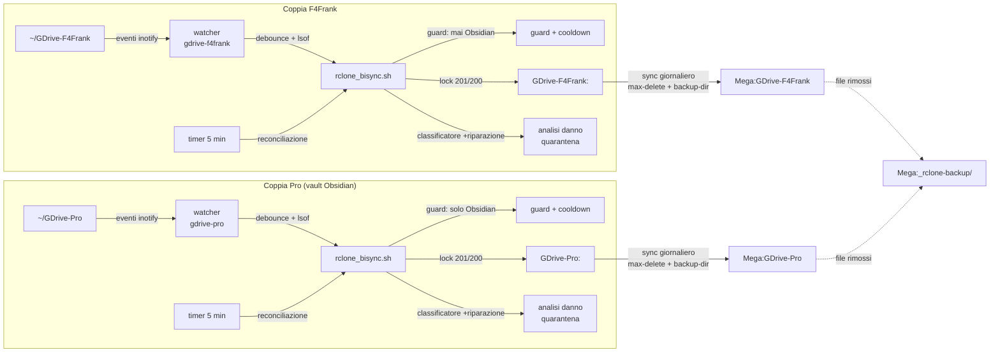
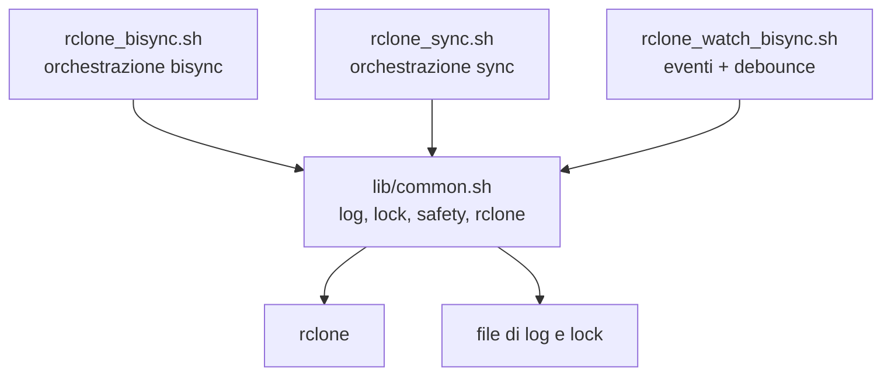
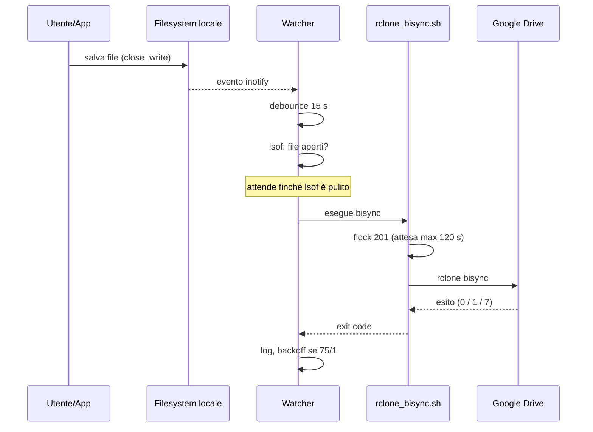
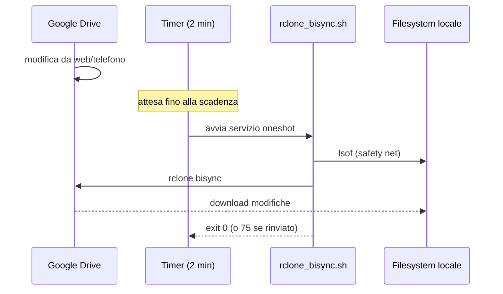
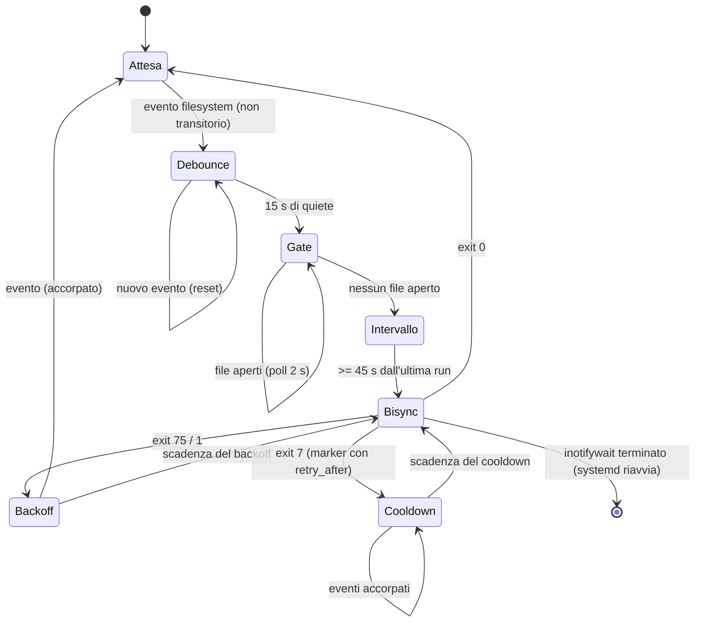

# Rclone Automation Suite — Documentazione tecnica

**Repository:** `rclone-automation-suite` **Utente target:** `frankel` **Motore di sincronizzazione:** `rclone bisync` (bidirezionale) e `rclone sync` (backup remoto→remoto) **Scheduler:** systemd user services e timer **Stato:** implementazione realtime completata e verificata

Questo documento è la documentazione tecnica di riferimento. Non presuppone conoscenza pregressa di `rclone`, `systemd`, `inotify`, `flock` o `lsof`: ogni concetto necessario per leggere il codice è spiegato nel glossario e nelle sezioni di dettaglio.

---

## 1. Scopo del sistema

Il sistema mantiene allineate, in modo bidirezionale, due coppie locale ↔ Google Drive:

- `~/GDrive-F4Frank` ↔ `GDrive-F4Frank:` (cartelle di lavoro e documenti);
- `~/GDrive-Pro` ↔ `GDrive-Pro:` (solo vault Obsidian: `Obsidian/`, con `.git` e lo stato volatile esclusi).

Per ciascuna coppia:

- **locale → remoto**: innescato dagli eventi del filesystem (tempo reale, secondi);
- **remoto → locale**: tramite un timer systemd (5 minuti, configurabile);
- **backup remoto → remoto**: verso Mega, ogni remote nella propria sottocartella (`Mega:GDrive-F4Frank`, `Mega:GDrive-Pro`), con esecuzione giornaliera.

L'obiettivo è ridurre al minimo le sincronizzazioni fallite o scartate:

- nessun job cron in attesa bloccato in RAM;
- nessuno skip dovuto al mtime dei file;
- un rinvio (`exit 75`) non viene confuso con un successo;
- gli eventi che arrivano durante una sincronizzazione non vengono persi.

Il sistema è inoltre **auto-riparante** e non richiede interventi manuali:

- gli errori vengono classificati (rete, quota, credenziali, cancellazioni di massa, errore critico) e trattati di conseguenza;
- un lato danneggiato viene ripristinato automaticamente dall'altro, senza propagare la cancellazione;
- un blocco non è mai permanente: prevede un cooldown crescente (15 min → 1 h → 6 h → 24 h) e un nuovo tentativo automatico;
- le strutture delle coppie sono protette da invarianti (in Pro solo il vault; in F4Frank mai il vault);
- le notifiche sono deduplicate: lo stesso problema non viene ripetuto a ogni run, e in assenza di rete non arriva nulla.

---

## 2. Glossario


| Termine | Significato |
| --- | --- |
| `remote` | Una destinazione configurata in rclone, indicata come `nome:percorso` (es. `GDrive-F4Frank:`). La presenza dei due punti distingue un remote da un percorso locale. |
| `bisync` | Comando rclone che sincronizza in modo bidirezionale due alberi, mantenendo due listing di stato e gestendo conflitti e cancellazioni. |
| `sync` | Comando rclone unidirezionale: rende la destinazione identica alla sorgente, incluse le cancellazioni. |
| `Path1` / `Path2` | I due alberi passati a `bisync`. Nel progetto Path1 è la cartella locale e Path2 il remote. |
| `listing` | Fotografia dello stato di un albero, salvata da bisync in `~/.cache/rclone/bisync/` e usata al run successivo. |
| `--resync` | Run speciale che ricostruisce i listing da zero. Va usato solo nei casi previsti dalla documentazione rclone: primo run, modifica dei filtri, errore critico. |
| `--check-access` | Controllo di sicurezza che richiede un file `RCLONE_TEST` su entrambi i lati, alla stessa profondità. Serve a evitare cancellazioni di massa se un lato non è accessibile. |
| `--max-delete` | Soglia oltre la quale rclone interrompe le cancellazioni. In `sync` è un numero di file; in `bisync` è una percentuale (default 50%). |
| `--backup-dir` | Cartella in cui rclone sposta i file che sostituisce o cancella, invece di eliminarli. |
| `--force` | Bypassa il controllo `--max-delete`: propaga una cancellazione di massa. Nel progetto è usato solo manualmente. |
| `--conflict-resolve` | Strategia di risoluzione dei conflitti. `newer` fa vincere il file con mtime più recente. |
| `--resync-mode` | Lato da cui prendere i file in conflitto durante un `--resync`: `path1` (locale) o `path2` (remote). |
| `guard` | Insieme di invarianti sulla struttura di una coppia (`GUARD_*` nel file `.env`): voci ammesse, vietate, da migrare. |
| `quarantena` | Spostamento dei file rimossi in `~/.local/share/rclone-quarantine/<data>/`, conservati 7 giorni invece di essere cancellati subito. |
| `cooldown` | Attesa crescente prima di un nuovo tentativo dopo un errore critico: 15 min, 1 h, 6 h, 24 h. Registrata nel marker `.blocked`. |
| `classificatore` | Funzione del modulo comune che riconosce la firma dell'errore nell'output di rclone (`classify_bisync_failure`). |
| `firma dei filtri` | Hash dei file di esclusione salvato in `state/filters_hash`. Se cambia, il run successivo esegue `--resync`. |
| `dry-run` | Modalità di prova: nessuna modifica ai dati; il guard elenca solo cosa farebbe. |
| `sync protetto` | Regola per cui un `sync` unidirezionale non può avere come destinazione un remote gestito da `bisync`. |
| `exit 0` | Successo. |
| `exit 1` | Errore generico rclone: il run è fallito ma può essere ritentato. |
| `exit 2` | Errore d'uso o di sintassi. |
| `exit 7` | Errore critico bisync, oppure blocco con cooldown: il run successivo è automatico. |
| `exit 75` | `EX_TEMPFAIL` (BSD sysexits): rinvio. Usato dal progetto per "file aperti", "lock occupato", "rete assente", "cooldown in corso". |
| `flock` | Lock advisory su un file. Nel progetto due descriptor: FD 201 (lock per remote) e FD 200 (lock per operazione). |
| `inotify` | Meccanismo del kernel Linux che notifica le modifiche al filesystem. |
| `inotifywait` | Programma di `inotify-tools` che espone gli eventi inotify. Con `-m` resta in ascolto. |
| `FIFO` | Named pipe: un canale tra due processi. Usata per non perdere gli eventi mentre il watcher esegue bisync. |
| `debounce` | Attesa di un periodo di quiete dopo l'ultimo evento, per non sincronizzare a ogni singolo salvataggio. |
| `lsof +D` | Elenca i file aperti sotto una directory, usato per capire se qualcuno sta ancora scrivendo. |
| `systemd user unit` | Unità gestita dal `systemd --user` dell'utente, non dal sistema. |
| `linger` | Impostazione che permette al `systemd --user` di restare attivo anche senza login grafico. |
| `EnvironmentFile` | File letto da systemd che definisce variabili d'ambiente per un servizio. |
| `Type=oneshot` | Servizio che esegue un comando e termina; systemd attende la fine. |
| `Type=simple` | Servizio long-running (il watcher). |
| `SuccessExitStatus` | Elenco di exit code considerati successo da systemd. |
| `logrotate` | Rotazione periodica dei file di log. |
| `notify-send` | Notifica desktop via D-Bus. |
| `DBUS_SESSION_BUS_ADDRESS` | Indirizzo del bus D-Bus della sessione utente. |

---

## 3. Architettura

### 3.1 Vista d'insieme



Ogni coppia ha il suo watcher (percorso veloce locale→remoto) e il suo timer (rete di sicurezza per il verso remoto→locale e per gli eventi persi a watcher fermo). I due remote Google Drive non si sincronizzano fra loro: finiscono separatamente, in sottocartelle distinte, nel backup su Mega.

Il `guard` è l'ultima linea di difesa: viene eseguito a ogni run, sotto lock, e riallinea la struttura della coppia agli invarianti dichiarati nel file `.env`. Il classificatore decide se un errore è ritentabile, se richiede un ripristino o se va solo rinviato.

### 3.2 Perché systemd user service


| Scelta | Motivo |
| --- | --- |
| User service invece di cron | I servizi girano come `frankel`, quindi accedono a `~/.config/rclone`, ai path locali e alla D-Bus della sessione per `notify-send`. |
| Timer invece di crontab | Gestione nativa del fuso orario, di `Persistent=` e dell'ordine rispetto alla rete (`After=network-online.target`). |
| `loginctl enable-linger` | I user service partono solo al login; `linger` li fa partire al boot anche senza sessione grafica. |
| Template `@` + `%i` | Una sola unità gestisce più istanze; i parametri arrivano da un file `.env` per istanza. |

### 3.3 Componenti


| Componente | Ruolo |
| --- | --- |
| `scripts/lib/common.sh` | Modulo condiviso: logging, notifiche con deduplica, validazione, percorsi, lock, safety check, classificazione degli errori, analisi del danno, guard degli invarianti, quarantena, cooldown, stato persistente. |
| `scripts/rclone_bisync.sh` | Esegue `rclone bisync` con lock, safety check, guard, classificazione degli errori e riparazione automatica. |
| `scripts/rclone_watch_bisync.sh` | Ascolta gli eventi del filesystem (ignorando quelli transitori), applica debounce e gate sui file aperti, lancia `rclone_bisync.sh`, ritenta con backoff e rispetta il cooldown. |
| `scripts/rclone_sync.sh` | Backup unidirezionale remoto→remoto con `rclone sync`, `--max-delete`, `--backup-dir`, lock su entrambi gli endpoint e protezione delle destinazioni bisync. |
| `setup.sh` | Installa script, unità, `.env`, cartelle dati (log, lock, stato), file di esclusione, configurazione logrotate utente, marker `RCLONE_TEST`; rimuove i wrapper legacy e le definizioni logrotate duplicate; abilita linger e servizi. |
| `unsetup.sh` | Rimuove tutto quanto sopra. |
| `config/exclude_patterns.txt` | Template delle esclusioni comuni, installato in `~/.config/rclone/`. |
| `config/exclude_obsidian.txt` | Esclusioni dell'istanza Pro: stato volatile del vault (`workspace.json`, `.trash/`, cache). |
| `systemd/user/*.service` | Template/istanze dei servizi, più il servizio di rotazione dei log. |
| `systemd/user/*.timer` | Timer di bisync (5 min), sync (giornaliero) e logrotate (giornaliero). |
| `systemd/user/*.env` | Parametri per istanza, inclusi gli invarianti `GUARD_*`. |
| `~/.config/rclone/exclude_patterns.txt` | Esclusioni comuni a tutti gli script. |
| `~/.config/rclone/exclude_obsidian.txt` | Esclusioni del vault, passate come secondo `--exclude-from`. |
| `~/.config/rclone/logrotate.conf` | Configurazione logrotate generata da `setup.sh`, usata dal timer utente. |
| `~/.config/rclone/conf_dir_<REMOTE>/` | Log, lock e stato per remote. |
| `~/.local/share/rclone-quarantine/` | File rimossi dal guard, conservati 7 giorni. |

### 3.4 Struttura del repository

```text
rclone-automation-suite/
├── AGENTS.md                     # questa documentazione
├── README.md                     # panoramica rapida
├── setup.sh                      # installazione (root)
├── unsetup.sh                    # disinstallazione (root)
├── config/
│   ├── exclude_patterns.txt      # template delle esclusioni comuni
│   └── exclude_obsidian.txt      # esclusioni del vault (istanza Pro)
├── scripts/
│   ├── lib/
│   │   └── common.sh             # modulo condiviso (log, lock, guard, riparazione)
│   ├── rclone_bisync.sh          # bisync con lock, guard e auto-riparazione
│   ├── rclone_sync.sh            # backup remoto -> remoto protetto
│   └── rclone_watch_bisync.sh    # watcher realtime con retry
├── systemd/user/
│   ├── rclone-bisync@.service    # template servizio bisync
│   ├── rclone-bisync@.timer      # template timer bisync (5 min)
│   ├── rclone-sync@.service      # template servizio sync
│   ├── rclone-sync@.timer        # template timer sync (giornaliero)
│   ├── rclone-bisync-watcher@.service
│   ├── rclone-logrotate.service  # rotazione log a livello utente
│   ├── rclone-logrotate.timer
│   ├── rclone-bisync-gdrive-f4frank.env
│   ├── rclone-bisync-gdrive-pro.env
│   ├── rclone-sync-f4frank-to-mega.env
│   └── rclone-sync-pro-to-mega.env
├── tests/
│   ├── run_all.sh                # esecuzione dell'intera suite
│   ├── README.md                 # guida ai test
│   ├── lib/testlib.sh            # libreria comune
│   ├── test_00_static.sh
│   ├── test_05_common.sh
│   ├── test_10_bisync.sh
│   ├── test_15_sync.sh
│   ├── test_20_watcher.sh
│   ├── test_25_healing.sh        # classificazione, cooldown, guard, quarantena
│   ├── test_30_setup_contract.sh
│   └── test_40_flags.sh
└── android/
    └── IMPLEMENTATION.md         # non modificare
```

### 3.5 Struttura a runtime

```text
~/.bin/
├── lib/
│   └── common.sh
├── rclone_bisync.sh
├── rclone_sync.sh
└── rclone_watch_bisync.sh

~/.config/systemd/user/
├── rclone-bisync@.service
├── rclone-bisync@.timer
├── rclone-sync@.service
├── rclone-sync@.timer
├── rclone-bisync-watcher@.service
├── rclone-logrotate.service
├── rclone-logrotate.timer
├── rclone-bisync-gdrive-f4frank.env
├── rclone-bisync-gdrive-pro.env
├── rclone-sync-f4frank-to-mega.env
└── rclone-sync-pro-to-mega.env

~/.config/rclone/
├── rclone.conf
├── exclude_patterns.txt
├── exclude_obsidian.txt
├── logrotate.conf
├── conf_dir_GDrive-F4Frank/
│   ├── log_files/
│   │   ├── bisync-GDrive-F4Frank.log
│   │   ├── watcher-GDrive-F4Frank.log
│   │   └── sync-GDrive-F4Frank_to_Mega.log
│   ├── lock_files/
│   │   ├── bisync-GDrive-F4Frank.lock
│   │   ├── remote-GDrive-F4Frank.lock
│   │   ├── bisync-GDrive-F4Frank.blocked
│   │   └── watcher-GDrive-F4Frank.fifo
│   └── state/
│       ├── filters_hash
│       ├── last_success
│       ├── streak
│       └── notify_<evento>
└── conf_dir_GDrive-Pro/
    ├── log_files/
    │   ├── bisync-GDrive-Pro.log
    │   ├── watcher-GDrive-Pro.log
    │   └── sync-GDrive-Pro_to_Mega.log
    ├── lock_files/
    │   ├── bisync-GDrive-Pro.lock
    │   ├── remote-GDrive-Pro.lock
    │   ├── bisync-GDrive-Pro.blocked
    │   └── watcher-GDrive-Pro.fifo
    └── state/
        └── ...

~/.local/share/rclone-quarantine/<AAAA-MM-GG-hhmmss-pid>/
└── <voci rimosse dal guard>

~/.local/state/rclone-logrotate.status
```

`~/.cache/rclone/bisync/` è invece gestita direttamente da rclone e contiene i listing di stato delle coppie sincronizzate. Non va cancellata manualmente salvo un `--resync` esplicito.

Il marker `.blocked` non è più un blocco permanente: contiene `reason`, `attempts` e `retry_after`, e viene consumato automaticamente alla scadenza del cooldown.

### 3.6 Moduli e responsabilità




| Modulo | Responsabilità |
| --- | --- |
| `scripts/lib/common.sh` | Tutto ciò che bisync e sync condividono: logging, notifiche, validazione, percorsi, lock, safety check, esecuzione rclone, marker di blocco. |
| `scripts/rclone_bisync.sh` | Orchestrazione bisync: argomenti, sicurezza locale, comando `RCLONE_CMD`, recupero e `--resync`. |
| `scripts/rclone_sync.sh` | Orchestrazione del backup remoto→remoto. |
| `scripts/rclone_watch_bisync.sh` | Eventi inotify, debounce, FIFO, backoff e sospensione. |

Gli entrypoint non duplicano logica: caricano il modulo con `. "${SCRIPT_DIR}/lib/common.sh"`, così lo stesso codice gira sia dal repository (`scripts/`) sia dopo l'installazione (`~/.bin/`).

---

## 4. Flussi operativi

### 4.1 Modifica locale → upload



### 4.2 Modifica remota → downloadP



### 4.3 Macchina a stati del watcher



Il watcher non si ferma mai per un errore di sincronizzazione: il cooldown è deciso da `rclone_bisync.sh` e registrato nel marker `.blocked`, che il watcher legge solo per sapere quando ritentare. Il retry è reale: avviene alla scadenza anche se non arriva nessun nuovo evento.

### 4.4 Modello di lock

Due lock annidati, sempre nello stesso ordine (201 poi 200) per evitare deadlock:


| Lock | File | Modalità | Scopo |
| --- | --- | --- | --- |
| FD 201 | `lock_files/remote-<REMOTE>.lock` | `flock -w 120` | Serializza tutte le operazioni sullo stesso remote (bisync, sync, copy). |
| FD 202 | `lock_files/remote-<REMOTE>.lock` | `flock -w 120` | Secondo endpoint di un backup remoto→remoto. |
| FD 200 | `lock_files/bisync-<REMOTE>.lock` | `flock -n` | Impedisce due bisync simultanee sulla stessa coppia. |

Comportamento:

- se il lock 201 è occupato si attende fino a `LOCK_WAIT` (default 120 s); oltre si esce con `75` (rinvio, non errore);
- se il lock 200 è occupato si esce subito con `75`;
- il timer e il watcher possono quindi incontrarsi senza generare "sync fallite".

Il backup `rclone_sync.sh` prende **entrambi** i lock remoti (sorgente e destinazione) in ordine alfabetico sul nome del remote: due backup in direzioni opposte non possono incastrarsi in un deadlock. Se sorgente e destinazione sono lo stesso remote, prende un solo lock.

### 4.5 Codici di uscita


| Codice | Significato nel progetto | Reazione |
| --- | --- | --- |
| `0` | Successo | il watcher riparte dallo stato di attesa; `last_success` e `filters_hash` aggiornati |
| `1` | Errore definitivo (config, permessi, disco, destinazione protetta) | notifica deduplicata; il watcher ritenta con backoff |
| `2` | Uso errato | correggere l'invocazione |
| `7` | Errore critico bisync o blocco con cooldown | il marker `.blocked` contiene `retry_after`; nuovo tentativo automatico |
| `75` | Rinvio (file aperti, lock occupato, rete assente, cooldown in corso) | il watcher ritenta con backoff; systemd non lo considera un fallimento |

### 4.6 Debounce, quiete e file aperti

Il watcher usa un solo processo `inotifywait -m -r` e una FIFO:

1. ogni evento viene scritto nella FIFO;
2. il loop legge il primo evento e poi continua a leggere con `read -t DEBOUNCE`: ogni nuovo evento resetta il timer;
3. quando la FIFO resta silenziosa per `DEBOUNCE` secondi, si passa al gate;
4. il gate esegue `lsof +D` ogni `LSOF_POLL` secondi finché ci sono file aperti;
5. solo allora viene invocato `rclone_bisync.sh`.

Questa sequenza sostituisce il vecchio `find -mmin -1`: dopo un salvataggio il mtime è sempre recente, quindi quel controllo rendeva impossibile qualsiasi sincronizzazione innescata da un evento.

Eventi che arrivano durante l'esecuzione di bisync restano nella FIFO e vengono consumati al termine, producendo una seconda run (che sarà un no-op se non ci sono altre modifiche).

### 4.7 Auto-riparazione

Il sistema non richiede interventi manuali: ogni errore viene classificato e trattato secondo una matrice fissa.

**Classificazione degli errori** (`classify_bisync_failure`):


| Classe | Firma riconosciuta | Azione automatica |
| --- | --- | --- |
| `too_many_deletes` | `Safety abort: too many deletes` | analisi del danno (vedi sotto) |
| `retryable` | `retryable without --resync` | rinvio `75`, nessun resync |
| `auth` | `401`, `invalid_grant`, `oauth2: cannot fetch token` | rinvio silenzioso; notifica solo dopo 6 fallimenti consecutivi |
| `rate_limit` | `rate limit`, `quota`, `429` | rinvio silenzioso `75` |
| `network` | `dial tcp`, `no such host`, `i/o timeout`, `connection reset` | rinvio silenzioso `75`, **nessuna notifica** |
| `critical` | `exit 7` senza firma nota | resync automatico (`path1`) |
| `other` | tutto il resto | rinvio `75`; notifica solo dopo 3 fallimenti consecutivi |

**Analisi del danno** (`bisync_damage_analysis`): confronta il numero di oggetti attuale con quello dei listing precedenti di bisync (nessuna chiamata API aggiuntiva) e con `rclone size`.


| Esito | Condizione | Azione |
| --- | --- | --- |
| `remote_damaged` | remoto ≤ 70% e locale ≥ 90% | `--resync --resync-mode path1`: il remoto viene ripristinato dal locale |
| `local_shrunk` | locale ≤ 70% e remoto ≥ 90% | `--resync --resync-mode path2`: i file mancanti tornano dal remoto |
| `both_shrunk` | entrambi ≤ 70% | come sopra: ripristino, mai propagazione della cancellazione |
| `unknown` | dati insufficienti o nessun calo | nessuna propagazione; blocco con cooldown |

Regola d'oro: **una cancellazione di massa non viene mai propagata automaticamente**. `--resync` copia solo ciò che manca e non cancella nulla, quindi il ripristino è sempre sicuro. Per propagare davvero una cancellazione voluta serve un intervento esplicito con `--force`.

**Cooldown del blocco** (`blocked_set` / `blocked_is_due`):


| Tentativo | Attesa prima del nuovo tentativo |
| --- | --- |
| 1 | 15 minuti |
| 2 | 1 ora |
| 3 | 6 ore |
| 4+ | 24 ore |

Il marker `.blocked` contiene `reason`, `attempts` e `retry_after`. Alla scadenza il run riparte da solo; al primo successo il marker viene rimosso e gli attempt azzerati.

**Invarianti delle coppie** (`guard_enforce`): eseguiti a ogni run, sotto lock, prima della sincronizzazione.

| Variabile `.env` | Effetto |
| --- | --- |
| `GUARD_ALLOWED_TOP_LEVEL` | voci ammesse nella radice; tutto il resto viene migrato in `GUARD_MIGRATE_TARGET` |
| `GUARD_FORBIDDEN_TOP_LEVEL` | voci sempre rimosse (quarantena locale + purge remoto) |
| `GUARD_PURGE_TOP_LEVEL` | come sopra, ma senza migrazione |
| `GUARD_MIGRATE_TARGET` | destinazione della migrazione (default `~/GDrive-F4Frank`) |

Configurazione attuale:

- **Pro**: `allowed=Obsidian`, `forbidden=Gestione Casa Fokou`, target `~/GDrive-F4Frank`. Se compare qualcosa che non è il vault, viene spostato in F4Frank (vince il file più recente) o eliminato se vietato.
- **F4Frank**: `forbidden=Obsidian`. Il vault non deve mai comparire qui: se compare, viene messo in quarantena e rimosso dal remote.

Le liste sono separate da `|` per permettere voci con spazi.

**Quarantena** (`guard_quarantine_move`): nulla viene cancellato subito. Le voci rimosse finiscono in `~/.local/share/rclone-quarantine/<data>-<pid>/` e vengono ripulite dopo 7 giorni (`QUARANTINE_DAYS`).

**Firma dei filtri** (`filters_signature`): hash di `exclude_patterns.txt` + `exclude_obsidian.txt`, salvato in `state/filters_hash`. Se cambia, il run successivo esegue `--resync` da solo: bisync non calcola l'hash di `--exclude-from` e senza questo accorgimento i file appena esclusi sembrerebbero cancellati.

**Notifiche deduplicate** (`notify_event` / `notify_clear`): ogni evento ha una chiave (`damage`, `critical`, `guard`, `blocked`, `streak`, `sync_error`, ...). Lo stesso messaggio non viene notificato due volte; quando lo stato torna sano la chiave viene azzerata e una nuova occorrenza torna visibile.

**Protezione del backup**: `rclone_sync.sh` rifiuta di scrivere su un remote gestito da bisync o sulla radice del backup (`SYNC_PROTECTED_DESTS`, default `GDrive-F4Frank|GDrive-Pro|Mega:`). È la rete di sicurezza contro i vecchi wrapper in `/etc/cron.daily` che sincronizzavano `GDrive-F4Frank: → GDrive-Pro:` e `GDrive-F4Frank: → Mega:`. In più `--max-delete 200` blocca le cancellazioni di massa e `--backup-dir Mega:_rclone-backup/<REMOTE>` conserva ciò che viene rimosso.

---

## 5. Codice in dettaglio

### 5.0 Modulo condiviso scripts/lib/common.sh

Il modulo è caricato dagli entrypoint con `. "${SCRIPT_DIR}/lib/common.sh"`. Non esegue `set -e`: la politica di uscita resta agli entrypoint.

**Configurazione tramite ambiente:**


| Variabile | Default | Uso |
| --- | --- | --- |
| `RCLONE_BIN` | `/usr/bin/rclone` | Binario rclone |
| `RCLONE_CONFIG_DIR` | `/home/frankel/.config/rclone` | Base per `conf_dir_*` |
| `RCLONE_EXCLUDE_FILE` | `$RCLONE_CONFIG_DIR/exclude_patterns.txt` | File di esclusione (obbligatorio) |
| `RCLONE_EXCLUDE_EXTRA` | vuoto | Secondo file di esclusione, per istanza |
| `NOTIFY_BIN` | `notify-send` | Binario delle notifiche |
| `NOTIFY_ENABLED` | `1` | `0` disabilita le notifiche (test) |
| `NOTIFY_TITLE` / `NOTIFY_APP` | impostati dagli entrypoint | Titolo e applicazione |
| `NOTIFY_MIN_LEVEL` | `WARN` | Livello minimo perché parta una notifica |
| `LOG_TAG` | `RCLONE` | Componente nella riga di log (`BISYNC`, `SYNC`, `WATCH`) |
| `DEBUG_MODE` | `0` | `1` manda l'output su stderr |
| `LOG_FULL_ON_SUCCESS` | `0` | `1` scrive l'intero output rclone anche sui successi |
| `LOCK_WAIT` | `120` | Attesa sul lock remoto |
| `LSOF_WAIT_SECONDS` | `10` | Intervallo tra due controlli lsof |
| `LSOF_MAX_RETRIES` | `18` | Tentativi lsof |
| `QUARANTINE_ROOT` | `~/.local/share/rclone-quarantine` | Base della quarantena |
| `QUARANTINE_DAYS` | `7` | Conservazione in quarantena |
| `BISYNC_CACHE_DIR` | `~/.cache/rclone/bisync` | Listing di bisync (per l'analisi del danno) |
| `GUARD_ALLOWED_TOP_LEVEL` | vuoto | Invariante: voci ammesse (lista separata da `\|`) |
| `GUARD_FORBIDDEN_TOP_LEVEL` | vuoto | Invariante: voci vietate (lista separata da `\|`) |
| `GUARD_PURGE_TOP_LEVEL` | vuoto | Invariante: voci da eliminare (lista separata da `\|`) |
| `GUARD_MIGRATE_TARGET` | `~/GDrive-F4Frank` | Destinazione della migrazione |

**Contratto delle funzioni:**


| Funzione | Contratto |
| --- | --- |
| `log_emit <stderr                                                             | file> <livello></livello> <msg></msg>` |
| `log_debug` / `log_info` / `log_warn` / `log_error` / `log_critical <msg>` | Scrivono su stderr (quindi nel file di log) con il livello indicato; `DEBUG` solo con `DEBUG_MODE=1`. |
| `log_text <livello> <testo>` | Come sopra, per testi multiriga (output di rclone, messaggi d'uso). |
| `log_line <file> <msg>` | Scrive un record `INFO` nel file indicato. |
| `log_line_at <file> <livello> <msg>` | Scrive un record del livello indicato nel file. |
| `log_message <msg>` | Compatibilità: alias di `log_debug`. |
| `log_summary <output>` | Estrae da un output rclone le righe `Transferred`, `Checks`, `Deleted`, `Errors`, `Elapsed time` e le scrive come record INFO. |
| `send_notification <msg> [livello]` | Notifica desktop con stile derivato dal livello (default `ERROR`); sotto `NOTIFY_MIN_LEVEL` non invia; non fallisce mai. |
| `notify_event <chiave> <livello> <msg>` | Notifica solo se il messaggio differisce dall'ultimo inviato per quella chiave (deduplica in `state/notify_<chiave>`). |
| `notify_clear <chiave>` | Dimentica lo stato di una chiave: la prossima occorrenza viene notificata. |
| `level_value <livello>` | Peso numerico del livello (DEBUG 10 … CRITICAL 50, 0 se sconosciuto). |
| `require_args <n> <atteso> <uso>` | Esce 1 se il conteggio non corrisponde. |
| `is_remote_path <path>` | 0 se contiene `:`, 1 altrimenti. |
| `remote_name_of <path>` | Stampa la parte prima di `:`. |
| `require_remote_path <path> <label> <uso>` | Esce 1 se manca `:`. |
| `require_configured_remote <name>` | Esce 1 se il remote non è configurato. |
| `require_exclude_files` | Esce 1 se `RCLONE_EXCLUDE_FILE` o `RCLONE_EXCLUDE_EXTRA` non esistono (errore parlante, non uscita silenziosa). |
| `conf_dir_for` / `log_dir_for` / `lock_dir_for` / `state_dir_for` / `blocked_file_for <remote>` | Stampa il percorso. |
| `init_rclone_paths <remote> <op> <log>` | Imposta `CONF_DIR`, `LOG_FILES_DIR`, `LOCK_FILES_DIR`, `STATE_DIR`, `LOCK_FILE_REMOTE`, `LOCK_FILE_OPERATION`, `BLOCKED_FILE`, `LOG_FILE`. |
| `state_get` / `state_set` / `state_del <chiave> [valore]` | Stato persistente in `STATE_DIR` (firma dei filtri, streak, deduplica notifiche). |
| `record_success` / `record_failure` / `failure_streak` | Aggiornano `last_success` e il contatore dei fallimenti consecutivi. |
| `ensure_runtime_dirs` | Crea log/lock/stato; esce 1 se fallisce. |
| `ensure_log_file` | Crea il log; esce 1 se fallisce. |
| `redirect_output_to_log` | Con `DEBUG_MODE=0` esegue `exec >> "$LOG_FILE" 2>&1`. |
| `require_local_dir <path>` | Esce 1 se la directory manca. |
| `ensure_local_check_file <path>` | Crea `RCLONE_TEST`; esce 1 se fallisce. |
| `check_local_write <path>` | Verifica la scrittura **senza creare file nell'albero sincronizzato** (il probe è in `$XDG_RUNTIME_DIR`): un file di prova in `LOCAL_PATH` innescherebbe il watcher a ogni run. |
| `wait_for_no_open_files <path> <poll> <max> [log]` | 0 quando non ci sono **file regolari** aperti (gli handle su directory, tipici delle app Electron, non bloccano), 1 allo scadere di `max`. Con `max=0` esegue un solo controllo. |
| `remote_is_reachable <name>` | 0 se `rclone about` riesce. |
| `remote_has_check_file <path>` | 0 se `RCLONE_TEST` esiste sul remote. |
| `ensure_remote_check_file <path>` | Crea `RCLONE_TEST`; esce 1 se fallisce. |
| `check_disk_space <path> [min_mb]` | Esce 1 sotto la soglia (default 1024 MB). |
| `run_rclone <comando...>` | Imposta `RCLONE_OUTPUT` e `RCLONE_RC`; ritorna sempre 0. |
| `is_critical_rc <rc>` | 0 se `rc == 7`. |
| `is_network_error` / `is_auth_error` / `is_rate_limit_error` / `is_retryable_without_resync` / `is_too_many_deletes <output>` | Riconoscono le firme note di rclone. |
| `classify_bisync_failure <rc> <output>` | Stampa `too_many_deletes`, `retryable`, `auth`, `rate_limit`, `network`, `critical` o `other`. |
| `rclone_size_count <path>` / `bisync_prev_counts <remote>` | Numero di oggetti ora e nei listing precedenti. |
| `bisync_damage_analysis <locale> <remote> <nome>` | Stampa `remote_damaged`, `local_shrunk`, `both_shrunk` o `unknown`. |
| `filters_signature <file...>` | Hash dei file di esclusione. |
| `guard_enforce <locale> <remote>` | Applica gli invarianti; imposta `GUARD_CHANGED` e `GUARD_SUMMARY`. Rispetta `DRY_RUN`. |
| `guard_quarantine_move <path>` / `guard_quarantine_prune` | Sposta in quarantena e ripulisce le voci più vecchie di `QUARANTINE_DAYS`. |
| `blocked_set <file> <motivo> <tentativo>` / `blocked_is_due <file>` / `blocked_attempts <file>` | Marker con cooldown (15m, 1h, 6h, 24h). |
| `mark_blocked` / `clear_blocked` / `is_blocked <file>` | Gestione marker legacy/compatibilità. |
| `acquire_remote_lock` / `acquire_operation_lock` | `flock -w $LOCK_WAIT 201` e `flock -n 200`. |

**Exit code del modulo:** `EXIT_OK=0`, `EXIT_ERROR=1`, `EXIT_CRITICAL=7`, `EXIT_TEMPFAIL=75`.

### 5.0.1 Formato di log e notifiche

Tutti i record passano da `log_emit`: nessuno script scrive log a mano. Un record occupa una sola riga, così `grep` e `journalctl` filtrano per livello o componente.

```text
[YYYY-MM-DD HH:MM:SS] [LIVELLO] [TAG] messaggio
```

Esempio reale:

```text
[2026-11-02 08:35:36] [INFO] [BISYNC] Lock bisync acquisito. Avvio rclone bisync per GDrive-F4Frank.
[2026-11-02 08:35:36] [WARN] [BISYNC] Rinvio (exit 75): lock generale occupato per GDrive-F4Frank (attesa 120s).
[2026-11-02 08:35:36] [ERROR] [BISYNC] Rclone bisync fallito (exit 1).
[2026-11-02 08:35:36] [CRITICAL] [BISYNC] Watcher sospeso fino a intervento manuale.
```

- un messaggio multiriga produce un record per riga, con lo stesso timestamp: una riga = un evento;
- `TAG` viene da `LOG_TAG`, impostato dagli entrypoint (`BISYNC`, `SYNC`, `WATCH`);
- i record `DEBUG` compaiono solo con `DEBUG_MODE=1`.

**Livelli:**


| Livello | Significato | Notifica (icona / urgenza) |
| --- | --- | --- |
| `DEBUG` | Dettaglio diagnostico, spento in produzione | — |
| `INFO` | Passo normale: lock acquisito, run completata | — |
| `WARN` | Rinvio, skip, attesa: il run non è fallito | `dialog-warning` / `normal` |
| `ERROR` | Errore definitivo o condizione da correggere | `dialog-error` / `normal` |
| `CRITICAL` | Richiede intervento manuale (`--resync`, permessi, disco) | `dialog-error` / `critical` |

**Notifiche:** il riepilogo è `"$NOTIFY_TITLE [$LIVELLO]"`, il corpo è il messaggio insieme alle ultime righe di rclone. `NOTIFY_MIN_LEVEL` (default `WARN`) evita notifiche per i passi normali; `NOTIFY_ENABLED=0` le disattiva del tutto nei test.

Esempio di riepilogo: `Rclone bisync GDrive-F4Frank [CRITICAL]`.

### 5.1 scripts/rclone_bisync.sh

Carica `lib/common.sh` e usa le funzioni condivise per validazione, percorsi, log, safety check, lock, guard, classificazione e riparazione. La logica specifica rimasta qui è il comando `RCLONE_CMD`, la preparazione del run (resync condizionato, cooldown) e le azioni di riparazione.

**Ingressi:** `$1` = directory locale, `$2` = `remote:percorso`, più le opzioni:

| Opzione | Effetto |
| --- | --- |
| `--resync` | forza un resync anche se la firma dei filtri non è cambiata |
| `--force` | passa `--force` a rclone (bypassa `--max-delete`); solo manuale |
| `--dry-run` | nessuna modifica ai dati; il guard elenca solo cosa farebbe |

**Fasi:**

1. **Validazione** — numero argomenti, presenza dei `:` nel remote, remote configurato (`rclone listremotes`).
2. **Percorsi** — `CONF_DIR`, `LOG_FILE`, `LOCK_FILE_REMOTE`, `LOCK_FILE_BISYNC`, `BLOCKED_FILE`, `STATE_DIR`.
3. **Preparazione** — crea `log_files/`, `lock_files/` e `state/`, crea il log se manca.
4. **Log** — con `DEBUG_MODE=0` esegue `exec >> "$LOG_FILE" 2>&1`. Con `DEBUG_MODE=1` l'output resta su stdout/stderr (utile solo per diagnosi manuale).
5. **Controlli locali** — directory locale, `RCLONE_TEST`, file di esclusione obbligatori, scrittura (probe fuori dall'albero), spazio libero (≥ 1 GB).
6. **Resync condizionato** — se `state/filters_hash` è assente e la coppia ha già dei listing, la firma viene adottata; se manca del tutto è il primo run e si fa `--resync`; se la firma è cambiata si fa `--resync`. Anche `state/needs_resync` (impostato dal guard) e la scadenza del cooldown forzano il resync.
7. **Cooldown** — se `.blocked` esiste e `retry_after` è nel futuro, esce subito con `75` senza tentare.
8. **Preflight remoto** — `rclone about`: se il remote non è raggiungibile esce con `75` **senza notificare** (rete assente). Poi verifica/crea `RCLONE_TEST`.
9. **Safety check** — attende che `lsof +D "$LOCAL_PATH"` non trovi **file regolari** aperti, per un massimo di `LSOF_WAIT_SECONDS * LSOF_MAX_RETRIES` (default 10 s × 18 = 3 min). Allo scadere esce con `75`.
10. **Lock** — apre FD 201 sul lock del remote con `flock -w "$LOCK_WAIT"`, poi FD 200 sul lock di bisync con `flock -n`. In caso di lock occupato esce con `75`.
11. **Guard** — applica gli invarianti della coppia. Se modifica qualcosa imposta `needs_resync`, notifica una volta e mette in quarantena ciò che rimuove.
12. **Comando rclone** — l'array `RCLONE_CMD` contiene i flag di produzione. **Non va modificato senza test dedicati**; i nuovi flag si aggiungono solo dopo la fase di test descritta in §9.6 o via `EXTRA_BISYNC_FLAGS`.
13. **Esecuzione** — cattura output e exit code con `RCLONE_OUTPUT=$(...) || RCLONE_RC=$?`.
14. **Errore** — `classify_bisync_failure` decide l'azione: rinvio silenzioso (rete/quota), rinvio con notifica dopo N fallimenti, resync automatico, analisi del danno con ripristino, oppure blocco con cooldown.
15. **Successo** — aggiorna `last_success`, salva `filters_hash`, rimuove `.blocked` e `needs_resync`, azzera la deduplica delle notifiche, scrive il riepilogo (`log_summary`) e termina con `0`.

**Flag del comando di produzione:**

```text
--exclude-from (comune + extra per istanza)
--check-access --resilient --recover --max-lock 2m
--fast-list --fix-case --compare modtime
--conflict-resolve newer --conflict-suffix conflict
--tpslimit 10 --tpslimit-burst 10
--checkers=16 --transfers=8 --retries 3 --low-level-retries 20 --retries-sleep 5s
--drive-chunk-size=128M --drive-pacer-min-sleep=10ms
--drive-export-formats docx,xlsx,pptx --drive-import-formats docx,xlsx,pptx
```

Note:

- `--drive-stop-on-upload-limit` è stato rimosso: trasformava un 403 transitorio in un `exit 7`, che il vecchio codice interpretava come errore critico (5 resync inutili su 7).
- `--remove-empty-dirs` non è più nel blocco: è attivo solo su F4Frank via `EXTRA_BISYNC_FLAGS`, perché nel vault le cartelle vuote fanno parte della struttura.
- `-v` è stato rimosso: il log cresceva di centinaia di MB; il riepilogo finale è sufficiente, l'intero output si vede con `LOG_FULL_ON_SUCCESS=1` o `DEBUG_MODE=1`.

**Perché il **`find -mmin -1`** è stato rimosso:** è vero per definizione subito dopo un salvataggio e trasformava ogni run realtime in uno skip silenzioso.

**Perché **`exit 75`**:** con `exit 0` un rinvio era indistinguibile da un successo, quindi systemd non segnalava nulla e il watcher non ritentava.

**Perché il resync è condizionato:** `--resync` non propaga le cancellazioni (i file cancellati possono riapparire) e non va eseguito mentre i file cambiano. La documentazione rclone lo consiglia solo per primo run, cambio filtri o errore critico.

### 5.2 scripts/rclone_watch_bisync.sh

Carica `lib/common.sh` per logging, notifiche, percorsi, marker e gate `lsof`. La logica specifica rimasta qui è l'ascolto inotify, la FIFO, il debounce, il backoff e la gestione del cooldown.

**Ingressi:** `$1` = directory locale, `$2` = remote, `$3` = debounce (default 15).

**Variabili d'ambiente:**


| Variabile | Default | Uso |
| --- | --- | --- |
| `MIN_INTERVAL` | 45 | secondi minimi tra due run |
| `LSOF_POLL` | 2 | intervallo di polling del gate |
| `LSOF_MAX_WAIT` | 1800 | attesa massima del gate (30 min) |
| `BACKOFF_START` | 10 | primo ritardo dopo un errore |
| `BACKOFF_MAX` | 300 | ritardo massimo (5 min) |
| `BISYNC_SCRIPT` | `/home/frankel/.bin/rclone_bisync.sh` | script da invocare |
| `WATCH_EXCLUDE` | regex predefinita | percorsi che non devono innescare una run (`.git/`, `.trash/`, `workspace.json`, file temporanei) |

**Struttura:**

1. verifica `inotifywait` e directory locale;
2. crea `log_files/`, `lock_files/` e `state/`, apre il log;
3. crea una FIFO, avvia `inotifywait -m -r --exclude ...` in background e registra un `trap` che termina il processo e rimuove la FIFO (`TERM`/`INT` escono davvero: senza `exit` il ciclo in backoff non si sbloccherebbe);
4. legge gli eventi dalla FIFO, applica debounce, gate `lsof`, intervallo minimo;
5. invoca `rclone_bisync.sh` e interpreta l'exit code:
   - `0` → azzera il backoff;
   - `75` → se c'è un cooldown attivo lo rispetta (`retry_after` dal marker), altrimenti backoff;
   - `7` → legge `retry_after` dal marker e ritenta alla scadenza (non si ferma mai);
   - altro → notifica deduplicata e backoff;
6. se `inotifywait` termina (EOF sulla FIFO), esce con `1` per far riavviare il servizio.

Il retry è **reale**: durante il backoff il watcher resta in ascolto con un timeout pari al tempo mancante, accorpa gli eventi e riparte alla scadenza anche senza nuove modifiche.

**Perché la FIFO:** con una pipeline il `while` girerebbe in una subshell, `exit` non terminerebbe lo script e `inotifywait` potrebbe restare bloccato. Con FIFO e processo in background il loop resta nella shell principale e il cleanup è deterministico.

**Perché **`read -t`**:** è il debounce vero: ogni evento resetta il timer; il timeout indica il silenzio. Il codice distingue il timeout (`rc > 128`) dall'EOF (`rc <= 128`), altrimenti alla morte di `inotifywait` resterebbe in attesa per sempre.

**Perché **`--exclude`** su inotifywait:** senza di esso ogni scrittura di `workspace.json` di Obsidian innescava una run (562 eventi su 570 nel log Pro). I file esclusi dai filtri di rclone non devono nemmeno svegliare il watcher.

**Perché il gate considera solo i file regolari:** `lsof +D` segnala anche gli handle sulle directory (Electron, IDE, file manager), che non indicano una scrittura in corso e bloccherebbero la sincronizzazione per sempre.

### 5.3 scripts/rclone_sync.sh

Carica `lib/common.sh` e usa le stesse funzioni di validazione, percorsi, log, lock ed esecuzione di bisync; cambia il comando rclone, la protezione delle cancellazioni e la gestione degli errori (nessun `--resync`).

Esegue `rclone sync "$SOURCE_PATH" "$DEST_PATH"` tra due remote, con lock su **entrambi** gli endpoint (FD 201 e 202, in ordine alfabetico di nome remote) e sugli stessi file di esclusione.

**Protezioni:**

- `SYNC_PROTECTED_DESTS` (default `GDrive-F4Frank|GDrive-Pro|Mega:`): rifiuta di scrivere su un remote gestito da bisync o sulla radice del backup. È la rete di sicurezza contro i due wrapper rimasti in `/etc/cron.daily` (`GDrive-F4Frank: GDrive-Pro:` che cancellava il vault e `GDrive-F4Frank: Mega:` che cancellava i backup): entrambi ora escono con `1` senza toccare nulla.
- `--max-delete "$SYNC_MAX_DELETE"` (default 200): oltre la soglia il run viene abortito e il backup resta intatto.
- `--backup-dir <DEST>:_rclone-backup/<REMOTE>`: i file sostituiti o rimossi vengono spostati lì invece di essere eliminati; la cartella è fuori dall'albero di destinazione per non essere risincronizzata su sé stessa.

**Errori:** rete/quota → `75` silenzioso; credenziali → `75` con notifica dopo 6 fallimenti; cancellazioni oltre soglia → `1` con notifica critica una sola volta; altro → `75` con notifica deduplicata.

Codici: `0` successo, `75` rinvio, `1` errore definitivo o cancellazione bloccata.


### 5.4 setup.sh

Richiede root. Passi:

1. verifica `EUID == 0`;
2. crea `~/.bin`, `~/.config/autostart`, `~/.config/systemd/user`, `~/.local/state`;
3. crea `conf_dir_<REMOTE>/{log_files,lock_files,state}`;
4. installa `config/exclude_patterns.txt` e `config/exclude_obsidian.txt` in `~/.config/rclone/`;
5. verifica `inotifywait`;
6. copia script, modulo comune, unità e `.env`, e li assegna all'utente con `chown` (in precedenza restavano `root:root` e l'utente non poteva aggiornarli);
7. abilita `linger`;
8. **rimuove i wrapper legacy** `/etc/cron.daily/wrapper_sync_drive_to_{drive,mega}.sh` (quelli che svuotavano il vault e i backup ogni notte);
9. **rimuove tutte le definizioni logrotate di sistema** `rclone_*` (erano duplicate e non funzionanti) e genera `~/.config/rclone/logrotate.conf` a partire da `LOGROTATE_INSTANCES`;
10. `daemon-reload` e `enable --now` dei timer (bisync, sync, logrotate);
11. crea `RCLONE_TEST` su entrambi i lati se manca;
12. abilita i due watcher;
13. rimuove le righe rclone dal crontab (marker `.bin/rclone_bisync.sh` e `.bin/rclone_sync.sh`).

È idempotente: `cp` sovrascrive, `enable --now` non duplica, `RCLONE_TEST` viene creato solo se assente e i file di esclusione vengono riscritti solo se diversi dal template (la versione precedente resta in `<file>.bak`).

Il logrotate di sistema usato in precedenza non funzionava: `/home/frankel` ha ACL `other::---` e SELinux blocca la lettura dei log, quindi `logrotate.service` falliva ogni notte con `stat ... Permission denied`. La rotazione ora gira come utente (`rclone-logrotate.service`), con stato in `~/.local/state/rclone-logrotate.status`.

### 5.5 unsetup.sh

Ferma e disabilita timer e watcher (incluso `rclone-logrotate.timer`), rimuove tutte le definizioni logrotate `rclone_*` da `/etc/logrotate.d`, la configurazione logrotate utente e il file di stato, le unità e i file `.env`, gli script da `~/.bin` (compreso `lib/common.sh`), i file di esclusione (o ripristina il `.bak` se esiste), i wrapper da `/etc/cron.daily`, il desktop file, le righe di crontab e i marker `.blocked`.

I log, i listing di bisync e la quarantena restano: la rimozione è volutamente manuale.

### 5.6 Unità systemd

`rclone-bisync@.service`

```ini
[Unit]
Description=Rclone bisync per istanza %i
Documentation=man:rclone(1)
After=network-online.target
Wants=network-online.target

[Service]
Type=oneshot
EnvironmentFile=-/home/frankel/.config/systemd/user/rclone-bisync-%i.env
ExecStart=/home/frankel/.bin/rclone_bisync.sh ${LOCAL_PATH} ${REMOTE_PATH}
SuccessExitStatus=75 7
Nice=10
IOSchedulingClass=best-effort
IOSchedulingPriority=7
TimeoutStartSec=2h

[Install]
WantedBy=timers.target
```

- `Type=oneshot`: lo script termina e il servizio è concluso.
- `SuccessExitStatus=75 7`: un rinvio (75) e un blocco con cooldown (7) non sono guasti del servizio, quindi non sporcano `systemctl --failed`.
- `EnvironmentFile=-`: il file è opzionale.
- `TimeoutStartSec=2h`: un run bloccato non resta appeso per sempre.

`rclone-bisync@.timer`

```ini
[Unit]
Description=Timer per rclone bisync (istanza %i)
Documentation=man:systemd.timer(5)

[Timer]
OnBootSec=1min
OnUnitActiveSec=5min
AccuracySec=10s
Unit=rclone-bisync@%i.service

[Install]
WantedBy=timers.target
```

- `OnUnitActiveSec=5min`: riconciliazione remoto→locale. Per ridurre il carico API si può portare a `10min`; è l'unica modifica necessaria.
- `AccuracySec=10s`: evita che l'accuratezza di default (1 min) allunghi l'intervallo.
- `Persistent=` è stato rimosso: con `OnUnitActiveSec` non ha effetto utile.

`rclone-bisync-watcher@.service`

```ini
[Unit]
Description=Watcher debounce realtime per rclone bisync istanza %i
Documentation=man:rclone(1)
After=network-online.target
Wants=network-online.target

[Service]
Type=simple
EnvironmentFile=-/home/frankel/.config/systemd/user/rclone-bisync-%i.env
Environment=MIN_INTERVAL=45 LSOF_POLL=2 LSOF_MAX_WAIT=1800 BACKOFF_START=10 BACKOFF_MAX=300
Environment=BISYNC_SCRIPT=/home/frankel/.bin/rclone_bisync.sh
ExecStart=/home/frankel/.bin/rclone_watch_bisync.sh ${LOCAL_PATH} ${REMOTE_PATH} 15
Restart=always
RestartSec=10
Nice=10

[Install]
WantedBy=default.target
```

- `Restart=always`: il watcher non si ferma più per un errore di sincronizzazione (il cooldown è gestito da `rclone_bisync.sh`); viene riavviato solo se termina davvero, cioè se `inotifywait` muore.

`rclone-sync@.service` e `rclone-sync@.timer`

```ini
[Service]
Type=oneshot
EnvironmentFile=-/home/frankel/.config/systemd/user/rclone-sync-%i.env
ExecStart=/home/frankel/.bin/rclone_sync.sh ${SOURCE_PATH} ${DEST_PATH}
SuccessExitStatus=75
Nice=15
IOSchedulingClass=idle
TimeoutStartSec=6h

[Timer]
OnBootSec=10min
OnCalendar=daily
RandomizedDelaySec=15min
Persistent=true
```

- `RandomizedDelaySec=15min` spalma le due istanze (f4frank e pro) invece di farle partire nello stesso istante.
- `IOSchedulingClass=idle` e `Nice=15`: il backup non deve mai contendere I/O con l'utente.

`rclone-logrotate.service` e `rclone-logrotate.timer`

```ini
[Service]
Type=oneshot
ExecStart=/usr/bin/logrotate --state %h/.local/state/rclone-logrotate.status %h/.config/rclone/logrotate.conf

[Timer]
OnCalendar=daily
RandomizedDelaySec=30min
Persistent=true
Unit=rclone-logrotate.service
```

- `%h`: home dell'utente, espansa da systemd nei servizi utente.
- Girando come utente non incontra le ACL di `/home/frankel` né SELinux.

### 5.7 File .env


| File | Contenuto |
| --- | --- |
| `rclone-bisync-gdrive-f4frank.env` | `LOCAL_PATH=/home/frankel/GDrive-F4Frank`, `REMOTE_PATH=GDrive-F4Frank:`, `GUARD_FORBIDDEN_TOP_LEVEL=Obsidian`, `EXTRA_BISYNC_FLAGS=--remove-empty-dirs` |
| `rclone-bisync-gdrive-pro.env` | `LOCAL_PATH=/home/frankel/GDrive-Pro`, `REMOTE_PATH=GDrive-Pro:`, `RCLONE_EXCLUDE_EXTRA=.../exclude_obsidian.txt`, `GUARD_ALLOWED_TOP_LEVEL=Obsidian`, `GUARD_FORBIDDEN_TOP_LEVEL=Gestione Casa Fokou`, `GUARD_MIGRATE_TARGET=/home/frankel/GDrive-F4Frank` |
| `rclone-sync-f4frank-to-mega.env` | `SOURCE_PATH=GDrive-F4Frank:`, `DEST_PATH=Mega:GDrive-F4Frank`, `SYNC_MAX_DELETE=200` |
| `rclone-sync-pro-to-mega.env` | `SOURCE_PATH=GDrive-Pro:`, `DEST_PATH=Mega:GDrive-Pro`, `SYNC_MAX_DELETE=200` |

Le liste `GUARD_*` sono separate da `|` per permettere voci con spazi (`Gestione Casa Fokou`).

### 5.8 Esclusioni e logrotate

Il template vive nel repository in `config/exclude_patterns.txt`; `setup.sh` lo installa in `~/.config/rclone/exclude_patterns.txt` (se il contenuto differisce, la versione precedente viene salvata in `exclude_patterns.txt.bak`). Il file installato è passato a tutti gli script con `--exclude-from`.

L'istanza Pro usa un secondo file, `config/exclude_obsidian.txt`, passato con un ulteriore `--exclude-from` tramite `RCLONE_EXCLUDE_EXTRA`. Contiene solo esclusioni del vault: `.obsidian/workspace.json`, `.obsidian/workspace-mobile.json`, `.trash/`, cache. Sono file che Obsidian riscrive in continuazione: sincronizzarli significa un conflitto a ogni run e un watcher che si auto-innesca.

Formato: un pattern glob per riga, non una regex.


| Pattern | Effetto |
| --- | --- |
| `Cartella/` | esclude la cartella e tutto il suo contenuto |
| `*.tmp` | esclude per estensione, a qualsiasi livello |
| `**/Cartella/**` | esclude una cartella con quel nome a qualsiasi profondità |

`**/Cartella/**` **non** copre la cartella posta nella radice: per escluderla a ogni livello servono due righe, `Cartella/` e `**/Cartella/**`. Verificare sempre con `rclone copy <sorgente> <destinazione-test> --exclude-from <file>`: un pattern che non corrisponde a nulla non dà errore, semplicemente non esclude niente.

**Cambiare le esclusioni richiede un **`--resync`**, che ora è automatico.** bisync non calcola l'hash di `--exclude-from` (lo fa solo con `--filters-file`), quindi non si accorge della modifica: i file appena esclusi sparirebbero dai listing e sembrerebbero cancellati, e bisync li eliminerebbe davvero. `filters_signature` salva l'hash dei file di esclusione in `state/filters_hash`: se cambia, il run successivo esegue `--resync` da solo. Il resync non cancella nulla: copia solo ciò che manca su un lato.

Le modifiche al file installato sono immediate; per renderle permanenti vanno portate nel template e `setup.sh` rieseguito.

La rotazione dei log è affidata a `rclone-logrotate.timer` (livello utente) con la configurazione generata in `~/.config/rclone/logrotate.conf`: `rotate 7`, `daily`, `compress`, `delaycompress`, `copytruncate`. `copytruncate` è necessario perché gli script tengono il file di log aperto con `exec >>`. Le definizioni in `/etc/logrotate.d/rclone_*` sono state rimosse: erano duplicate e non funzionavano (ACL e SELinux).

---

## 6. Scelte implementative e motivazioni


| Scelta | Motivo | Impatto |
| --- | --- | --- |
| Watcher event-driven + timer di riconciliazione | bisync non ha un watch: il locale→remoto può essere event-driven, il remoto→locale richiede polling | latenza locale→remoto di secondi; remoto→locale ≤ 5 min |
| Un solo `inotifywait -m` su FIFO | evita finestre cieche e perdita di eventi durante la sync | nessun evento perso |
| `--exclude` su `inotifywait` | lo stato volatile del vault generava centinaia di eventi inutili | niente run innescate da `workspace.json` |
| Debounce 15 s | evita un bisync a ogni salvataggio | meno chiamate API |
| Gate `lsof` a polling, solo file regolari | "riparte appena non ci sono file attivi" senza attendere un nuovo evento; gli handle su directory non bloccano | la sync riparte da sola alla chiusura |
| Rimozione di `find -mmin -1` | incompatibile con il realtime | niente skip per mtime recente |
| Lock 201/200 con `flock` | watcher e timer si sovrappongono | attesa limitata, poi rinvio |
| Lock 201+202 sul backup | due sync in direzioni opposte non devono incastrarsi | nessun deadlock |
| `exit 75` per i rinvii | distingue rinvio da successo | systemd non segna failed; il watcher ritenta |
| `--resync` condizionato (filtri, guard, exit 7) | `--resync` non propaga le cancellazioni ed è pericoloso con file in scrittura | resync solo quando serve |
| Classificatore degli errori | un unico ramo "errore non critico" trattava `too many deletes` come un rinvio per sempre | ogni errore ha l'azione corretta |
| Ripristino invece di propagazione | la cancellazione di massa non deve mai essere replicata | nessuna perdita di dati in caso di danno |
| Marker `.blocked` con cooldown | un blocco permanente richiedeva intervento manuale | riparte da solo: 15m → 1h → 6h → 24h |
| Guard degli invarianti | Pro e F4Frank si erano contaminati a vicenda | struttura delle coppie garantita a ogni run |
| Quarantena 7 giorni | "elimina" non deve significare "irrecuperabile" | le rimozioni restano annullabili |
| Timer a 5 min | copre il verso remoto→locale | meno chiamate API rispetto a 2 min |
| `--conflict-resolve newer` | i conflitti restano "tieni entrambi" e si accumulano | vince la versione più recente, il perdente resta `.conflict1` |
| `--remove-empty-dirs` solo su F4Frank | nel vault le cartelle vuote sono struttura | il vault non viene sfoltito |
| `--compare modtime` mantenuto | scelta esplicita dell'utente | non confronta la dimensione |
| `--max-delete` + `--backup-dir` sul backup | il wrapper legacy cancellava 484 file per notte | le cancellazioni di massa sono bloccate e reversibili |
| `SYNC_PROTECTED_DESTS` | un `sync` verso un remote bisync cancella il lato remoto | l'errore non è più possibile |
| Log con solo riepilogo | `-v` produceva 400 MB di log in due settimane | log leggibili e rotazione efficace |
| logrotate utente | quello di sistema falliva ogni notte (ACL/SELinux) | rotazione reale, nessun errore giornaliero |

---

## 7. Limiti noti e comportamento atteso

- `--remove-empty-dirs` (attivo solo su F4Frank) elimina le directory vuote a ogni run: una cartella appena creata e non ancora popolata può sparire.
- `--compare modtime` non confronta la dimensione: una modifica di contenuto senza variazione di mtime non viene rilevata.
- Con `--conflict-resolve newer` il perdente viene rinominato `.conflict1` e conservato: i file di conflitto si accumulano.
- `lsof +D` costa O(albero): su alberi molto grandi il gate è più lento.
- La coda inotify del kernel può overfloware su burst enormi (default 16384 eventi); il timer riconcilia comunque.
- Il verso remoto→locale resta a polling: non esiste un push verso la cartella locale.
- Una cancellazione di massa non viene mai propagata automaticamente: se è voluta serve `rclone_bisync.sh <locale> <remote> --force` (e i file restano nel cestino Drive per 30 giorni).
- L'analisi del danno si basa sui listing precedenti: se non esistono (primo run) restituisce `unknown` e non propaga nulla.
- Il backup su Mega conserva in `_rclone-backup/` solo l'ultima versione sostituita o rimossa di ogni percorso: non è uno storico versionato.
- Durante il backup giornaliero la coppia di origine è impegnata dal lock generale (FD 201): le sincronizzazioni realtime di quella coppia restano in attesa e ripartono da sole appena il backup finisce (al massimo 5 minuti dopo). È una scelta di coerenza: il backup legge un albero che nessun altro sta modificando.
- La migrazione tra coppie (guard) usa `cp -au` e `rclone copy --update`: vince il mtime, non il contenuto. Due file con lo stesso mtime e contenuto diverso (es. export docx) restano quello già presente nella destinazione.
- Su Google Drive possono esistere due oggetti con lo stesso nome visibile (un Google Doc nativo e un `.docx` caricato): rclone li esporta con lo stesso nome e i conteggi remoti risultano più alti di quelli locali. `rclone check --one-way` resta pulito perché il file locale è presente; è un duplicato lato Drive, non un errore di sincronizzazione.

---

## 8. Installazione e aggiornamento

### 8.1 Prerequisiti

```bash
sudo dnf install rclone inotify-tools util-linux lsof logrotate libnotify
```

- `rclone` ≥ 1.66 (qui testato con 1.75.2);
- `inotify-tools` per il watcher;
- `util-linux` per `flock`;
- `lsof` per il gate sui file aperti;
- `logrotate` per la rotazione;
- `libnotify` per `notify-send`.

### 8.2 Prima installazione

```bash
sudo ./setup.sh
```

Lo script richiede root per `linger`, la rimozione dei wrapper in `/etc/cron.daily` e delle definizioni logrotate di sistema, e per il `chown` dei file installati. Al termine verifica con:

```bash
systemctl --user list-timers --all | grep rclone
systemctl --user status rclone-bisync-watcher@gdrive-f4frank.service
systemctl --user status rclone-bisync-watcher@gdrive-pro.service
ls -la ~/.config/rclone/conf_dir_GDrive-F4Frank/log_files/
ls -la ~/.config/rclone/conf_dir_GDrive-Pro/log_files/
ls /etc/cron.daily/ | grep wrapper || echo "wrapper legacy assenti"
ls /etc/logrotate.d/ | grep rclone || echo "definizioni logrotate di sistema assenti"
```

### 8.3 Aggiornamento del codice

Dopo aver modificato gli script nel repository:

```bash
sudo ./setup.sh
systemctl --user daemon-reload
systemctl --user restart rclone-bisync-watcher@gdrive-f4frank.service
systemctl --user restart rclone-bisync-watcher@gdrive-pro.service
```

`setup.sh` sovrascrive gli script in `~/.bin`, il modulo `lib/common.sh` e le unità; i timer non vanno ricreati. Disattiva da solo le istanze non più previste (`rclone-sync@drive-to-drive`, `rclone-sync@drive-to-mega`), ne rimuove i file `.env`, elimina i wrapper legacy e rigenera `logrotate.conf`.

Se il servizio non riesce a leggere un file appena installato, controllare il proprietario: tutti i file devono essere `frankel:frankel` (il vecchio `setup.sh` li lasciava `root:root`).

### 8.4 Esecuzione manuale di un servizio

L'istanza è il suffisso del file `.env`: `gdrive-f4frank`, `gdrive-pro` (bisync), `f4frank-to-mega`, `pro-to-mega` (sync).

```bash
systemctl --user start rclone-bisync@gdrive-pro.service
systemctl --user status rclone-bisync@gdrive-pro.service --no-pager
journalctl --user -u rclone-bisync@gdrive-pro.service -n 50 --no-pager
```

Per una prova senza modificare i dati (il guard elenca solo cosa farebbe):

```bash
DEBUG_MODE=1 ~/.bin/rclone_bisync.sh ~/GDrive-Pro GDrive-Pro: --dry-run
```

Per propagare una cancellazione di massa voluta (operazione manuale, mai automatica):

```bash
~/.bin/rclone_bisync.sh ~/GDrive-Pro GDrive-Pro: --force
```

### 8.5 Migrazione alla topologia a due coppie

La migrazione è stata eseguita una tantum e non va ripetuta. Ordine seguito:

1. fermati watcher e timer;
2. backup degli script e delle unità precedenti in `~/.local/share/rclone-backup-<data>/`;
3. log troncati (erano 180 MB + 412 MB di abort ripetuti);
4. `--dry-run` della coppia Pro per verificare il piano del guard;
5. run reale: il guard ha migrato `00-Documenti` in `~/GDrive-F4Frank` (newest wins), messo in quarantena `Gestione Casa Fokou` e l'ha rimossa dal remote, poi ha eseguito il resync caricando il vault;
6. verifica con `rclone check` e conteggi;
7. riavvio di timer e watcher.

Il contenuto legacy nella radice di `Mega:` va rimosso dopo aver verificato i nuovi backup (`Mega:GDrive-F4Frank` e `Mega:GDrive-Pro`).

---

## 9. Test

### 9.1 Verifiche statiche

```bash
bash -n scripts/lib/common.sh
bash -n scripts/rclone_bisync.sh
bash -n scripts/rclone_sync.sh
bash -n scripts/rclone_watch_bisync.sh
bash -n setup.sh
bash -n unsetup.sh

# Intera suite (statica + moduli + watcher + contratto setup + flag)
./tests/run_all.sh

systemd-analyze verify systemd/user/rclone-bisync@.service \
                        systemd/user/rclone-bisync@.timer \
                        systemd/user/rclone-sync@.service \
                        systemd/user/rclone-sync@.timer \
                        systemd/user/rclone-bisync-watcher@.service \
                        systemd/user/rclone-logrotate.service \
                        systemd/user/rclone-logrotate.timer
```

L'avviso "Command ... is not executable" è atteso finché `setup.sh` non ha copiato gli script in `~/.bin`.


| File | Copertura |
| --- | --- |
| `tests/test_00_static.sh` | Sintassi, presenza dei file, riferimenti incrociati nella documentazione, flag di auto-riparazione, protezione delle cancellazioni. |
| `tests/test_05_common.sh` | Contratti di `scripts/lib/common.sh`: costanti, validazione, percorsi, log, `run_rclone`, marker, gate lsof, controlli remote/locali. |
| `tests/test_10_bisync.sh` | Lock, rinvii, resync, marker, errori di `rclone_bisync.sh`. |
| `tests/test_15_sync.sh` | Validazione, run normale, lock 201/202, cancellazioni bloccate, errori di `rclone_sync.sh`. |
| `tests/test_20_watcher.sh` | Gate lsof, ripresa, evento durante la run, debounce, eventi transitori ignorati, retry automatico, rispetto del cooldown, cleanup. |
| `tests/test_25_healing.sh` | Classificazione degli errori, cooldown, firma dei filtri, analisi del danno, merge newest-wins, guard e quarantena, deduplica delle notifiche, assenza di auto-innesco. |
| `tests/test_30_setup_contract.sh` | Contratto di `setup.sh`/`unsetup.sh` sulle unità, sui file installati, sui wrapper legacy e sul logrotate utente. |
| `tests/test_40_flags.sh` | Nuovi flag rclone su una coppia locale usa-e-getta (richiede `rclone` reale). |

### 9.2 Test unitari con stub di rclone

Lo scopo è verificare lock, rinvii, resync e watcher senza toccare Google Drive. Il principio: si copiano i moduli reali (`common.sh` + entrypoint) in una directory temporanea e si punta `RCLONE_BIN` a uno stub. Nessun `sed` sui sorgenti: path e binari si sostituiscono con le variabili d'ambiente che il modulo già legge.

```bash
T="${TMPDIR:-$HOME/.cache}/rt-test"
rm -rf "$T"
mkdir -p "$T/bin" "$T/lib" "$T/src" "$T/conf/conf_dir_tst/log_files" \
         "$T/conf/conf_dir_tst/lock_files" "$T/logs"

cat > "$T/bin/rclone" <<'EOS'
#!/bin/bash
case "$1" in
  listremotes) printf 'tst:\n'; exit 0 ;;
  about|lsf|touch) exit 0 ;;
  bisync|sync)
      n=$(cat "${COUNT_FILE:-/dev/null}" 2>/dev/null || echo 0)
      n=$((n + 1)); echo "$n" > "${COUNT_FILE:-/dev/null}"
      if [ "${STUB_FAIL_ALWAYS:-0}" != "0" ]; then exit "$STUB_FAIL_ALWAYS"; fi
      if [ "${STUB_FAIL_FIRST:-0}" = "1" ] && [ "$n" -eq 1 ]; then exit 7; fi
      sleep "${STUB_SLEEP:-1}"; exit 0 ;;
  *) exit 0 ;;
esac
EOS
chmod +x "$T/bin/rclone"

cp scripts/lib/common.sh "$T/lib/common.sh"
cp scripts/rclone_bisync.sh "$T/bisync.sh"
cp scripts/rclone_sync.sh "$T/sync.sh"
cp scripts/rclone_watch_bisync.sh "$T/watch.sh"
chmod +x "$T/bisync.sh" "$T/sync.sh" "$T/watch.sh"

export RCLONE_BIN="$T/bin/rclone"
export RCLONE_CONFIG_DIR="$T/conf"
export NOTIFY_ENABLED=0

# Stub usato dai test del watcher: registra ogni chiamata
cat > "$T/stub_bisync.sh" <<EOS
#!/bin/bash
echo "[\$(date +%s)] CALL \$*" >> "$T/logs/calls.log"
sleep "\${STUB_BISYNC_SLEEP:-1}"
exit "\${STUB_BISYNC_RC:-0}"
EOS
chmod +x "$T/stub_bisync.sh"
```

**A. Lock remoto occupato**

```bash
bash -c 'exec 9>"'"$T"'/conf/conf_dir_tst/lock_files/remote-tst.lock"; flock -n 9; sleep 6' &
LOCK_WAIT=1 "$T/bisync.sh" "$T/src" "tst:"
echo "rc=$? (atteso 75)"
```

**B. File aperto**

```bash
touch "$T/src/open.txt"
bash -c 'exec 9<"'"$T"'/src/open.txt"; sleep 6' &
LSOF_WAIT_SECONDS=1 LSOF_MAX_RETRIES=2 "$T/bisync.sh" "$T/src" "tst:"
echo "rc=$? (atteso 75)"
```

**C. Successo**

```bash
STUB_SLEEP=0 "$T/bisync.sh" "$T/src" "tst:"
echo "rc=$? (atteso 0)"
```

**D. Errore ritentabile (rclone exit 1)**

```bash
STUB_FAIL_ALWAYS=1 "$T/bisync.sh" "$T/src" "tst:"
echo "rc=$? (atteso 75, nessun resync)"
```

**E. Errore critico con resync riuscito**

```bash
export COUNT_FILE="$T/logs/count"
rm -f "$COUNT_FILE" "$T/conf/conf_dir_tst/lock_files/bisync-tst.blocked"
STUB_FAIL_FIRST=1 STUB_SLEEP=0 "$T/bisync.sh" "$T/src" "tst:"
echo "rc=$? (atteso 0); marker=$([ -f "$T/conf/conf_dir_tst/lock_files/bisync-tst.blocked" ] && echo presente || echo assente)"
```

**F. Errore critico con resync fallito**

```bash
STUB_FAIL_ALWAYS=7 "$T/bisync.sh" "$T/src" "tst:"
echo "rc=$? (atteso 7); marker=$([ -f "$T/conf/conf_dir_tst/lock_files/bisync-tst.blocked" ] && echo presente || echo assente)"
```

### 9.3 Test del watcher

```bash
BISYNC_SCRIPT="$T/stub_bisync.sh" \
STUB_BISYNC_SLEEP=2 MIN_INTERVAL=1 LSOF_POLL=0.5 LSOF_MAX_WAIT=60 \
  "$T/watch.sh" "$T/src" "tst:" 2
```

Casi da verificare:

1. **File aperto**: creare un file, tenerlo aperto in lettura; nessuna chiamata a bisync finché resta aperto.
2. **Ripresa alla chiusura**: chiudere il file; la run parte entro il debounce, senza attendere un altro evento.
3. **Evento durante la run**: modificare un file mentre lo stub dorme; al termine della run deve partire una seconda run.
4. **Cleanup**: `kill -TERM` del watcher; nessun `inotifywait` residuo e FIFO rimossa.

Controllo dei log:

```bash
# solo gli eventi che richiedono attenzione
grep -E '\[(WARN|ERROR|CRITICAL)\]' \
  ~/.config/rclone/conf_dir_GDrive-F4Frank/log_files/watcher-GDrive-F4Frank.log
tail -n 50 ~/.config/rclone/conf_dir_GDrive-F4Frank/log_files/watcher-GDrive-F4Frank.log
tail -n 50 ~/.config/rclone/conf_dir_GDrive-F4Frank/log_files/bisync-GDrive-F4Frank.log
```

### 9.4 Test di lock e concorrenza

Avviare due istanze contemporaneamente con un rclone lento e verificare che la seconda esca con `75` (non con `1`) e che non restino processi appesi:

```bash
STUB_SLEEP=30 "$T/bisync.sh" "$T/src" "tst:" & A=$!
sleep 2
LOCK_WAIT=1 "$T/bisync.sh" "$T/src" "tst:"
echo "rc=$? (atteso 75)"
kill $A 2>/dev/null; wait $A 2>/dev/null
pgrep -af "bisync.sh" || echo "nessun processo residuo"
```

### 9.5 Test systemd end-to-end

```bash
sudo ./setup.sh
systemctl --user daemon-reload
systemctl --user start rclone-bisync-watcher@gdrive-f4frank.service
systemctl --user start rclone-bisync-watcher@gdrive-pro.service
systemctl --user status rclone-bisync-watcher@gdrive-pro.service --no-pager
journalctl --user -u rclone-bisync-watcher@gdrive-pro.service -f
```

Test funzionale: creare un file nella cartella locale, verificare che compaia sul Drive; modificarlo dal web, verificare che compaia in locale entro il timer.

**Test di errore critico**: creare il marker e verificare che il watcher si fermi su 75:

```bash
touch ~/.config/rclone/conf_dir_GDrive-F4Frank/lock_files/bisync-GDrive-F4Frank.blocked
systemctl --user restart rclone-bisync-watcher@gdrive-f4frank.service
systemctl --user status rclone-bisync-watcher@gdrive-f4frank.service --no-pager
rm ~/.config/rclone/conf_dir_GDrive-F4Frank/lock_files/bisync-GDrive-F4Frank.blocked
systemctl --user start rclone-bisync-watcher@gdrive-f4frank.service
```

### 9.6 Test dei nuovi flag (prima di modificarli nel blocco)

`--conflict-resolve newer` e `--resync-mode newer` non sono nel blocco. Per testarli, usare una coppia locale usa-e-getta e appendere il flag alla riga di comando:

```bash
BASE="$HOME/bisync-flagtest"
rm -rf "$BASE"; mkdir -p "$BASE/p1" "$BASE/p2"
rclone touch "$BASE/p1/RCLONE_TEST"; rclone touch "$BASE/p2/RCLONE_TEST"
rclone bisync "$BASE/p1" "$BASE/p2" --resync --check-access

printf 'P1\n' > "$BASE/p1/f.txt"; printf 'P2\n' > "$BASE/p2/f.txt"
touch -d '2026-01-01 10:00:00' "$BASE/p2/f.txt"
touch -d '2026-01-01 10:05:00' "$BASE/p1/f.txt"

rclone bisync "$BASE/p1" "$BASE/p2" \
  --exclude-from "$HOME/.config/rclone/exclude_patterns.txt" \
  --remove-empty-dirs --check-access --resilient --recover --max-lock 2m \
  --fast-list --fix-case --compare modtime \
  --conflict-resolve newer -v

rclone lsf "$BASE/p1"; rclone lsf "$BASE/p2"
```

Esiti attesi:


| Caso | Esito |
| --- | --- |
| P1 più recente | `f.txt` = versione P1 su entrambi; `f.txt.conflict1` = versione P2 |
| P2 più recente | speculare |
| mtime uguali | fallback a `none`: `.conflict1` e `.conflict2` |
| `--resync` con conflitto | `--conflict-resolve` è ignorato; con `--resync-mode newer` vince il più recente |

Solo dopo l'esito positivo si aggiunge il flag al blocco `RCLONE_CMD` e si usa `--resync-mode newer` nel ramo di resync.

### 9.7 Matrice dei risultati attesi


| Test | Atteso |
| --- | --- |
| Lock remoto occupato | `75` entro pochi secondi |
| File aperto | `75` dopo il budget di tentativi |
| Run normale | `0` |
| rclone exit 1 | `75`, nessun resync |
| exit 7 + resync ok | `0`, marker assente |
| exit 7 + resync ko | `7`, marker con `retry_after` |
| Errore di rete | `75`, **nessuna notifica** |
| `too many deletes` con remote danneggiato | resync `path1`, `0` |
| `too many deletes` con locale ridotto | resync `path2` (ripristino), `0` |
| `too many deletes` senza dati | blocco con cooldown, nessuna propagazione |
| Cooldown in corso | `75` immediato, nessuna chiamata a rclone |
| Guard: voce vietata | rimossa da locale e remote, copia in quarantena |
| Guard: voce non ammessa in Pro | migrata in F4Frank, vince il più recente |
| Guard `--dry-run` | nessuna modifica, solo righe `WARN` nel log |
| Sync verso un remote bisync | `1`, rifiutato, nessuna modifica |
| Sync oltre `--max-delete` | `1`, backup intatto |
| Watcher con file aperto | 0 chiamate |
| Watcher dopo chiusura | 1 chiamata |
| Evento durante la run | 2 chiamate |
| `workspace.json` modificato | 0 chiamate |
| Errore ripetuto | retry automatico senza nuovi eventi |
| Cleanup watcher | nessun processo, FIFO rimossa |

---

## 10. Troubleshooting


| Sintomo | Causa probabile | Rimedio |
| --- | --- | --- |
| systemd mostra `Result: exit-code` con 75 | rinvio | se `SuccessExitStatus=75 7` è presente non è un errore; controllare i log |
| Il watcher non parte | `inotify-tools` assente o directory locale mancante | `sudo dnf install inotify-tools`; verificare `LOCAL_PATH` |
| `RCLONE_TEST` mancante | `--check-access` fallisce | `rclone touch <remote>:RCLONE_TEST` e `touch <locale>/RCLONE_TEST` |
| `lock generale occupato` ripetuto | un'altra operazione sullo stesso remote | attendere: è un rinvio, non un errore |
| `Blocco temporaneo (tentativo N)` | errore critico o danno non determinabile | nessuna azione: riparte da solo alla scadenza |
| `Bloccato fino a ...` nel log | cooldown in corso | attendere; per forzare subito rimuovere il marker `.blocked` |
| `Cancellazioni bloccate` sul backup | la sorgente ha perso più di `SYNC_MAX_DELETE` file | verificare la sorgente; se la cancellazione è voluta, alzare `SYNC_MAX_DELETE` nel `.env` |
| `Destinazione rifiutata` nel sync | destinazione = remote bisync | rimuovere il job che lo invoca (wrapper legacy in `/etc/cron.daily`) |
| `File di esclusione mancante` | `~/.config/rclone/exclude_*.txt` assente | `sudo ./setup.sh` |
| Log vuoto | `DEBUG_MODE=1` o permessi sul file | impostare `0` e verificare i permessi di `log_files/` |
| Log che cresce troppo | `LOG_FULL_ON_SUCCESS=1` | lasciare `0`; la rotazione è gestita da `rclone-logrotate.timer` |
| Molte chiamate API / 429 | timer troppo frequente | portare `OnUnitActiveSec` a `10min` |
| `bisync` lento su alberi grandi | listing completi | valutare `--disable ListR`, ridurre la frequenza |
| Notifiche assenti | `NOTIFY_ENABLED=0`, DBus non raggiungibile o livello sotto `NOTIFY_MIN_LEVEL` | verificare `DBUS_SESSION_BUS_ADDRESS`; i messaggi restano nel log |
| Notifica ripetuta a ogni run | chiave di deduplica non azzerata | controllare `state/notify_<chiave>`; `notify_clear` avviene al successo |
| `Permission denied` sui file in `~/.bin` | file rimasti `root:root` | `sudo ./setup.sh` (ora esegue `chown`) |
| `logrotate.service` fallisce ogni notte | ACL/SELinux sulla home | normale: la rotazione è `rclone-logrotate.timer` (utente), le definizioni di sistema sono rimosse |

---

## 11. Aggiungere una nuova istanza di sincronizzazione

1. Creare un file `.env` in `systemd/user/`, ad esempio `rclone-bisync-documenti.env`:

```bash
LOCAL_PATH=/home/frankel/Documenti
REMOTE_PATH=GDrive-F4Frank:Documenti
```
1. Creare le directory dati (oppure rieseguire `setup.sh` dopo aver aggiunto il remote all'elenco `RCLONE_REMOTES`):

```bash
mkdir -p ~/.config/rclone/conf_dir_GDrive-F4Frank/{log_files,lock_files}
```
1. Abilitare il timer e il watcher:

```bash
systemctl --user daemon-reload
systemctl --user enable --now rclone-bisync@documenti.timer
systemctl --user enable --now rclone-bisync-watcher@documenti.service
```
1. Aggiungere il log del watcher a logrotate (`setup.sh` va aggiornato per renderlo permanente).

---

## 12. Disinstallazione

```bash
sudo ./unsetup.sh
```

Rimuove timer, watcher, unità, `.env`, script da `~/.bin`, logrotate, wrapper legacy, desktop file, crontab e marker `.blocked`. I log e i listing di bisync restano in `~/.config/rclone/` e `~/.cache/rclone/bisync/`: la rimozione è volutamente manuale.

---

## 13. Riferimenti

- Documentazione rclone bisync: [https://rclone.org/bisync/](https://rclone.org/bisync/)
- Documentazione rclone mount (per il polling remoto): [https://rclone.org/commands/rclone_mount/](https://rclone.org/commands/rclone_mount/)
- systemd.timer: `man systemd.timer`
- systemd.service: `man systemd.service`
- inotify-tools: `man inotifywait`
- `flock`: `man flock`
