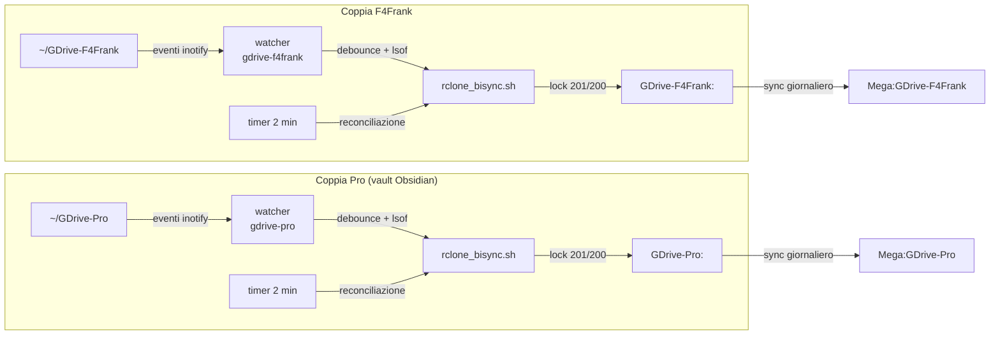
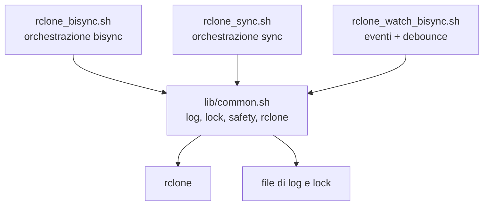
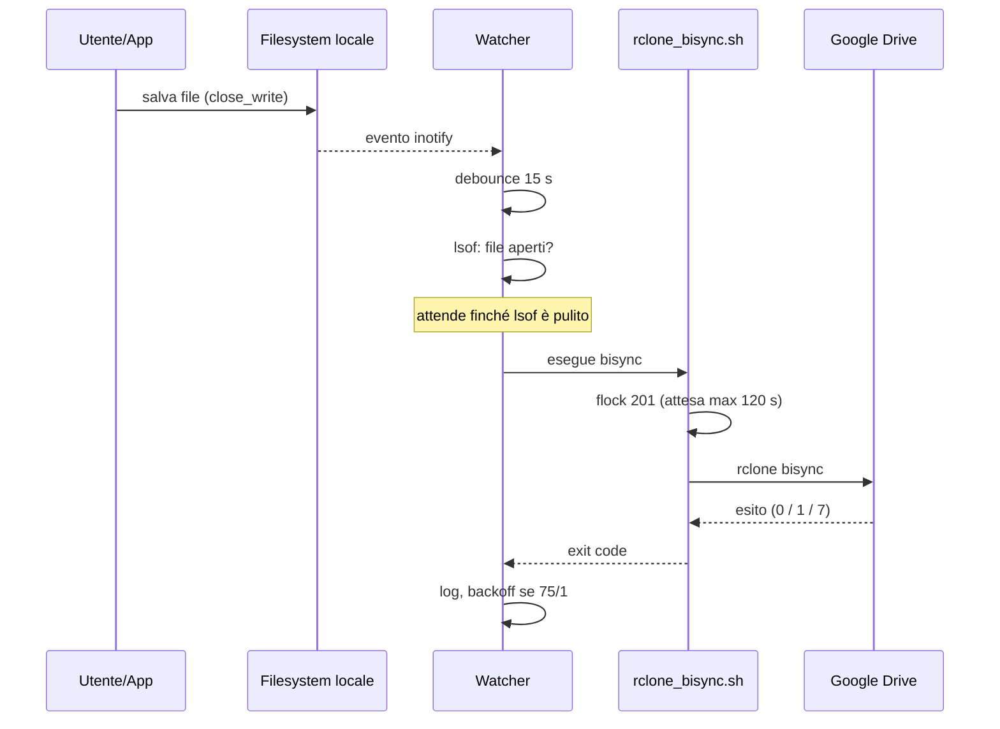
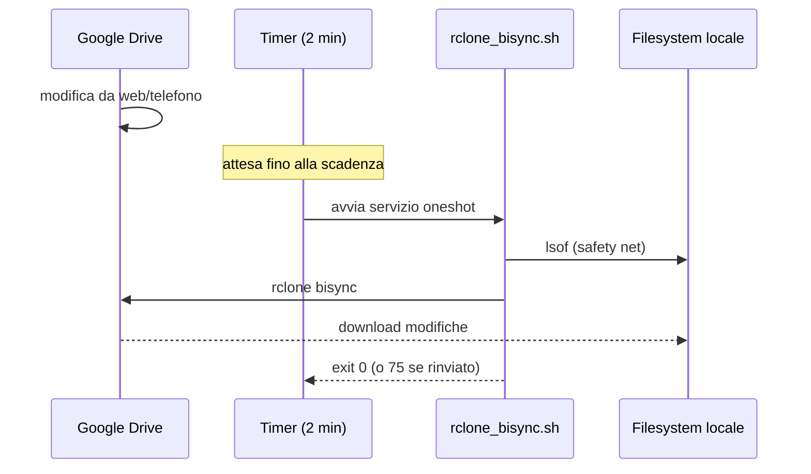
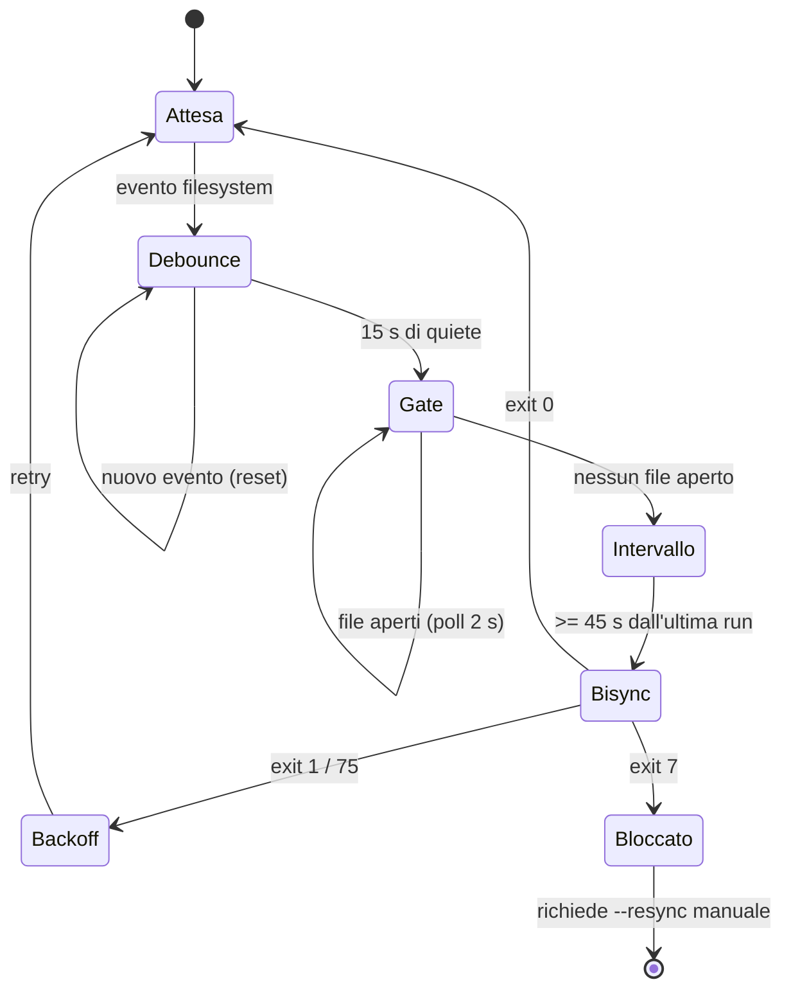

# Rclone Automation Suite — Documentazione tecnica

**Repository:** `rclone-automation-suite` **Utente target:** `frankel` **Motore di sincronizzazione:** `rclone bisync` (bidirezionale) e `rclone sync` (backup remoto→remoto) **Scheduler:** systemd user services e timer **Stato:** implementazione realtime completata e verificata

Questo documento è la documentazione tecnica di riferimento. Non presuppone conoscenza pregressa di `rclone`, `systemd`, `inotify`, `flock` o `lsof`: ogni concetto necessario per leggere il codice è spiegato nel glossario e nelle sezioni di dettaglio.

---

## 1. Scopo del sistema

Il sistema mantiene allineate, in modo bidirezionale, due coppie locale ↔ Google Drive:

- `~/GDrive-F4Frank` ↔ `GDrive-F4Frank:` (cartelle di lavoro e documenti);
- `~/GDrive-Pro` ↔ `GDrive-Pro:` (vault Obsidian, con la cartella `.git` esclusa).

Per ciascuna coppia:

- **locale → remoto**: innescato dagli eventi del filesystem (tempo reale, secondi);
- **remoto → locale**: tramite un timer systemd (circa 2 minuti, configurabile);
- **backup remoto → remoto**: verso Mega, ogni remote nella propria sottocartella (`Mega:GDrive-F4Frank`, `Mega:GDrive-Pro`), con esecuzione giornaliera.

L'obiettivo è ridurre al minimo le sincronizzazioni fallite o scartate:

- nessun job cron in attesa bloccato in RAM;
- nessuno skip dovuto al mtime dei file;
- un rinvio (`exit 75`) non viene confuso con un successo;
- gli eventi che arrivano durante una sincronizzazione non vengono persi.

---

## 2. Glossario


| Termine                    | Significato                                                                                                                                                                  |
| ---------------------------- | ------------------------------------------------------------------------------------------------------------------------------------------------------------------------------ |
| `remote`                   | Una destinazione configurata in rclone, indicata come `nome:percorso` (es. `GDrive-F4Frank:`). La presenza dei due punti distingue un remote da un percorso locale.          |
| `bisync`                   | Comando rclone che sincronizza in modo bidirezionale due alberi, mantenendo due listing di stato e gestendo conflitti e cancellazioni.                                       |
| `sync`                     | Comando rclone unidirezionale: rende la destinazione identica alla sorgente, incluse le cancellazioni.                                                                       |
| `Path1` / `Path2`          | I due alberi passati a `bisync`. Nel progetto Path1 è la cartella locale e Path2 il remote.                                                                                 |
| `listing`                  | Fotografia dello stato di un albero, salvata da bisync in `~/.cache/rclone/bisync/` e usata al run successivo.                                                               |
| `--resync`                 | Run speciale che ricostruisce i listing da zero. Va usato solo nei casi previsti dalla documentazione rclone: primo run, modifica dei filtri, errore critico.                |
| `--check-access`           | Controllo di sicurezza che richiede un file `RCLONE_TEST` su entrambi i lati, alla stessa profondità. Serve a evitare cancellazioni di massa se un lato non è accessibile. |
| `exit 0`                   | Successo.                                                                                                                                                                    |
| `exit 1`                   | Errore generico rclone: il run è fallito ma può essere ritentato.                                                                                                          |
| `exit 2`                   | Errore d'uso o di sintassi.                                                                                                                                                  |
| `exit 7`                   | Errore critico bisync: richiede un `--resync`.                                                                                                                               |
| `exit 75`                  | `EX_TEMPFAIL` (BSD sysexits): rinvio. Usato dal progetto per "file aperti" o "lock occupato".                                                                                |
| `flock`                    | Lock advisory su un file. Nel progetto due descriptor: FD 201 (lock per remote) e FD 200 (lock per operazione).                                                              |
| `inotify`                  | Meccanismo del kernel Linux che notifica le modifiche al filesystem.                                                                                                         |
| `inotifywait`              | Programma di `inotify-tools` che espone gli eventi inotify. Con `-m` resta in ascolto.                                                                                       |
| `FIFO`                     | Named pipe: un canale tra due processi. Usata per non perdere gli eventi mentre il watcher esegue bisync.                                                                    |
| `debounce`                 | Attesa di un periodo di quiete dopo l'ultimo evento, per non sincronizzare a ogni singolo salvataggio.                                                                       |
| `lsof +D`                  | Elenca i file aperti sotto una directory, usato per capire se qualcuno sta ancora scrivendo.                                                                                 |
| `systemd user unit`        | Unità gestita dal `systemd --user` dell'utente, non dal sistema.                                                                                                            |
| `linger`                   | Impostazione che permette al `systemd --user` di restare attivo anche senza login grafico.                                                                                   |
| `EnvironmentFile`          | File letto da systemd che definisce variabili d'ambiente per un servizio.                                                                                                    |
| `Type=oneshot`             | Servizio che esegue un comando e termina; systemd attende la fine.                                                                                                           |
| `Type=simple`              | Servizio long-running (il watcher).                                                                                                                                          |
| `SuccessExitStatus`        | Elenco di exit code considerati successo da systemd.                                                                                                                         |
| `logrotate`                | Rotazione periodica dei file di log.                                                                                                                                         |
| `notify-send`              | Notifica desktop via D-Bus.                                                                                                                                                  |
| `DBUS_SESSION_BUS_ADDRESS` | Indirizzo del bus D-Bus della sessione utente.                                                                                                                               |

---

## 3. Architettura

### 3.1 Vista d'insieme



Ogni coppia ha il suo watcher (percorso veloce locale→remoto) e il suo timer (rete di sicurezza per il verso remoto→locale e per gli eventi persi a watcher fermo). I due remote Google Drive non si sincronizzano fra loro: finiscono separatamente, in sottocartelle distinte, nel backup su Mega.

### 3.2 Perché systemd user service


| Scelta                      | Motivo                                                                                                                               |
| ----------------------------- | -------------------------------------------------------------------------------------------------------------------------------------- |
| User service invece di cron | I servizi girano come `frankel`, quindi accedono a `~/.config/rclone`, ai path locali e alla D-Bus della sessione per `notify-send`. |
| Timer invece di crontab     | Gestione nativa del fuso orario, di `Persistent=` e dell'ordine rispetto alla rete (`After=network-online.target`).                  |
| `loginctl enable-linger`    | I user service partono solo al login; `linger` li fa partire al boot anche senza sessione grafica.                                   |
| Template `@` + `%i`         | Una sola unità gestisce più istanze; i parametri arrivano da un file `.env` per istanza.                                           |

### 3.3 Componenti


| Componente                              | Ruolo                                                                                                                          |
| ----------------------------------------- | -------------------------------------------------------------------------------------------------------------------------------- |
| `scripts/lib/common.sh`                 | Modulo condiviso: logging, notifiche, validazione, percorsi, lock, safety check, esecuzione rclone.                            |
| `scripts/rclone_bisync.sh`              | Esegue `rclone bisync` con lock, safety check, gestione exit code e recupero.                                                  |
| `scripts/rclone_watch_bisync.sh`        | Ascolta gli eventi del filesystem, applica debounce e gate sui file aperti, lancia `rclone_bisync.sh`.                         |
| `scripts/rclone_sync.sh`                | Backup unidirezionale remoto→remoto con `rclone sync`.                                                                        |
| `setup.sh`                              | Installa script, unità, `.env`, cartelle dati, file di esclusione, logrotate, marker `RCLONE_TEST`, abilita linger e servizi. |
| `unsetup.sh`                            | Rimuove tutto quanto sopra.                                                                                                    |
| `config/exclude_patterns.txt`           | Template delle esclusioni, installato in `~/.config/rclone/`.                                                                  |
| `systemd/user/*.service`                | Template/istanze dei servizi.                                                                                                  |
| `systemd/user/*.timer`                  | Timer di bisync e sync.                                                                                                        |
| `systemd/user/*.env`                    | Parametri per istanza.                                                                                                         |
| `~/.config/rclone/exclude_patterns.txt` | Esclusioni comuni a tutti gli script.                                                                                          |
| `~/.config/rclone/conf_dir_<REMOTE>/`   | Log e lock per remote.                                                                                                         |

### 3.4 Struttura del repository

```text
rclone-automation-suite/
├── AGENTS.md                     # questa documentazione
├── README.md                     # panoramica rapida
├── setup.sh                      # installazione (root)
├── unsetup.sh                    # disinstallazione (root)
├── config/
│   └── exclude_patterns.txt      # template delle esclusioni rclone
├── scripts/
│   ├── lib/
│   │   └── common.sh             # modulo condiviso (log, lock, safety, rclone)
│   ├── rclone_bisync.sh          # bisync con lock e safety check
│   ├── rclone_sync.sh            # sync remoto -> remoto
│   └── rclone_watch_bisync.sh    # watcher realtime
├── systemd/user/
│   ├── rclone-bisync@.service    # template servizio bisync
│   ├── rclone-bisync@.timer      # template timer bisync
│   ├── rclone-sync@.service      # template servizio sync
│   ├── rclone-sync@.timer        # template timer sync
│   ├── rclone-bisync-watcher@.service
│   ├── rclone-bisync-gdrive-f4frank.env
│   ├── rclone-bisync-gdrive-pro.env
│   ├── rclone-sync-f4frank-to-mega.env
│   └── rclone-sync-pro-to-mega.env
├── tests/
│   ├── run_all.sh                # esecuzione dell'intera suite
│   ├── README.md                 # guida ai test
│   ├── lib/testlib.sh            # libreria comune
│   ├── test_00_static.sh
│   ├── test_10_bisync.sh
│   ├── test_20_watcher.sh
│   ├── test_30_setup_contract.sh
│   └── test_40_flags.sh
└── android/
    └── IMPLEMENTATION.md         # non modificare
```

### 3.5 Struttura a runtime

```text
~/.bin/
├── rclone_bisync.sh
├── rclone_sync.sh
└── rclone_watch_bisync.sh

~/.config/systemd/user/
├── rclone-bisync@.service
├── rclone-bisync@.timer
├── rclone-sync@.service
├── rclone-sync@.timer
├── rclone-bisync-watcher@.service
├── rclone-bisync-gdrive-f4frank.env
├── rclone-bisync-gdrive-pro.env
├── rclone-sync-f4frank-to-mega.env
└── rclone-sync-pro-to-mega.env

~/.config/rclone/
├── rclone.conf
├── exclude_patterns.txt
├── conf_dir_GDrive-F4Frank/
│   ├── log_files/
│   │   ├── bisync-GDrive-F4Frank.log
│   │   ├── watcher-GDrive-F4Frank.log
│   │   └── sync-GDrive-F4Frank_to_Mega.log
│   └── lock_files/
│       ├── bisync-GDrive-F4Frank.lock
│       ├── remote-GDrive-F4Frank.lock
│       ├── bisync-GDrive-F4Frank.blocked
│       └── watcher-GDrive-F4Frank.fifo
└── conf_dir_GDrive-Pro/
    ├── log_files/
    │   ├── bisync-GDrive-Pro.log
    │   ├── watcher-GDrive-Pro.log
    │   └── sync-GDrive-Pro_to_Mega.log
    └── lock_files/
        ├── bisync-GDrive-Pro.lock
        ├── remote-GDrive-Pro.lock
        ├── bisync-GDrive-Pro.blocked
        └── watcher-GDrive-Pro.fifo

/etc/logrotate.d/
├── rclone_bisync_gdrive-f4frank
├── rclone_bisync_gdrive-pro
├── rclone_watcher_gdrive-f4frank
├── rclone_watcher_gdrive-pro
├── rclone_sync_f4frank-to-mega
└── rclone_sync_pro-to-mega
```

`~/.cache/rclone/bisync/` è invece gestita direttamente da rclone e contiene i listing di stato delle coppie sincronizzate. Non va cancellata manualmente salvo un `--resync` esplicito.

### 3.6 Moduli e responsabilità




| Modulo                           | Responsabilità                                                                                                                               |
| ---------------------------------- | ----------------------------------------------------------------------------------------------------------------------------------------------- |
| `scripts/lib/common.sh`          | Tutto ciò che bisync e sync condividono: logging, notifiche, validazione, percorsi, lock, safety check, esecuzione rclone, marker di blocco. |
| `scripts/rclone_bisync.sh`       | Orchestrazione bisync: argomenti, sicurezza locale, comando `RCLONE_CMD`, recupero e `--resync`.                                              |
| `scripts/rclone_sync.sh`         | Orchestrazione del backup remoto→remoto.                                                                                                     |
| `scripts/rclone_watch_bisync.sh` | Eventi inotify, debounce, FIFO, backoff e sospensione.                                                                                        |

Gli entrypoint non duplicano logica: caricano il modulo con `. "${SCRIPT_DIR}/lib/common.sh"`, così lo stesso codice gira sia dal repository (`scripts/`) sia dopo l'installazione (`~/.bin/`).

---

## 4. Flussi operativi

### 4.1 Modifica locale → upload



### 4.2 Modifica remota → download



### 4.3 Macchina a stati del watcher



### 4.4 Modello di lock

Due lock annidati, sempre nello stesso ordine (201 poi 200) per evitare deadlock:


| Lock   | File                              | Modalità      | Scopo                                                                    |
| -------- | ----------------------------------- | ---------------- | -------------------------------------------------------------------------- |
| FD 201 | `lock_files/remote-<REMOTE>.lock` | `flock -w 120` | Serializza tutte le operazioni sullo stesso remote (bisync, sync, copy). |
| FD 200 | `lock_files/bisync-<REMOTE>.lock` | `flock -n`     | Impedisce due bisync simultanee sulla stessa coppia.                     |

Comportamento:

- se il lock 201 è occupato si attende fino a `LOCK_WAIT` (default 120 s); oltre si esce con `75` (rinvio, non errore);
- se il lock 200 è occupato si esce subito con `75`;
- il timer e il watcher possono quindi incontrarsi senza generare "sync fallite".

### 4.5 Codici di uscita


| Codice | Significato nel progetto                  | Reazione                                                               |
| -------- | ------------------------------------------- | ------------------------------------------------------------------------ |
| `0`    | Successo                                  | il watcher riparte dallo stato di attesa                               |
| `1`    | Errore generico / permessi / disco        | il watcher ritenta con backoff                                         |
| `2`    | Uso errato                                | correggere l'invocazione                                               |
| `7`    | Errore critico bisync                     | viene creato `.blocked`; serve `--resync` manuale                      |
| `75`   | Rinvio (file aperti, lock occupato, rete) | il watcher ritenta con backoff; systemd non lo considera un fallimento |

### 4.6 Debounce, quiete e file aperti

Il watcher usa un solo processo `inotifywait -m -r` e una FIFO:

1. ogni evento viene scritto nella FIFO;
2. il loop legge il primo evento e poi continua a leggere con `read -t DEBOUNCE`: ogni nuovo evento resetta il timer;
3. quando la FIFO resta silenziosa per `DEBOUNCE` secondi, si passa al gate;
4. il gate esegue `lsof +D` ogni `LSOF_POLL` secondi finché ci sono file aperti;
5. solo allora viene invocato `rclone_bisync.sh`.

Questa sequenza sostituisce il vecchio `find -mmin -1`: dopo un salvataggio il mtime è sempre recente, quindi quel controllo rendeva impossibile qualsiasi sincronizzazione innescata da un evento.

Eventi che arrivano durante l'esecuzione di bisync restano nella FIFO e vengono consumati al termine, producendo una seconda run (che sarà un no-op se non ci sono altre modifiche).

---

## 5. Codice in dettaglio

### 5.0 Modulo condiviso `scripts/lib/common.sh`

Il modulo è caricato dagli entrypoint con `. "${SCRIPT_DIR}/lib/common.sh"`. Non esegue `set -e`: la politica di uscita resta agli entrypoint.

**Configurazione tramite ambiente:**


| Variabile                     | Default                                   | Uso                                                      |
| ------------------------------- | ------------------------------------------- | ---------------------------------------------------------- |
| `RCLONE_BIN`                  | `/usr/bin/rclone`                         | Binario rclone                                           |
| `RCLONE_CONFIG_DIR`           | `/home/frankel/.config/rclone`            | Base per `conf_dir_*`                                    |
| `RCLONE_EXCLUDE_FILE`         | `$RCLONE_CONFIG_DIR/exclude_patterns.txt` | File di esclusione                                       |
| `NOTIFY_BIN`                  | `notify-send`                             | Binario delle notifiche                                  |
| `NOTIFY_ENABLED`              | `1`                                       | `0` disabilita le notifiche (test)                       |
| `NOTIFY_TITLE` / `NOTIFY_APP` | impostati dagli entrypoint                | Titolo e applicazione                                    |
| `NOTIFY_MIN_LEVEL`            | `WARN`                                    | Livello minimo perché parta una notifica                |
| `LOG_TAG`                     | `RCLONE`                                  | Componente nella riga di log (`BISYNC`, `SYNC`, `WATCH`) |
| `DEBUG_MODE`                  | `0`                                       | `1` manda l'output su stderr                             |
| `LOCK_WAIT`                   | `120`                                     | Attesa sul lock remoto                                   |
| `LSOF_WAIT_SECONDS`           | `10`                                      | Intervallo tra due controlli lsof                        |
| `LSOF_MAX_RETRIES`            | `18`                                      | Tentativi lsof                                           |

**Contratto delle funzioni:**


| Funzione                                                                      | Contratto                                                                                                                     |
| ------------------------------------------------------------------------------- | ------------------------------------------------------------------------------------------------------------------------------- |
| `log_emit <stderr                                                             | file> <livello></livello> <msg></msg>`                                                                                        |
| `log_debug` / `log_info` / `log_warn` / `log_error` / `log_critical <msg>`    | Scrivono su stderr (quindi nel file di log) con il livello indicato; `DEBUG` solo con `DEBUG_MODE=1`.                         |
| `log_text <livello> <testo>`                                                  | Come sopra, per testi multiriga (output di rclone, messaggi d'uso).                                                           |
| `log_line <file> <msg>`                                                       | Scrive un record `INFO` nel file indicato.                                                                                    |
| `log_line_at <file> <livello> <msg>`                                          | Scrive un record del livello indicato nel file.                                                                               |
| `log_message <msg>`                                                           | Compatibilità: alias di `log_debug`.                                                                                         |
| `send_notification <msg> [livello]`                                           | Notifica desktop con stile derivato dal livello (default `ERROR`); sotto `NOTIFY_MIN_LEVEL` non invia; non fallisce mai.      |
| `level_value <livello>`                                                       | Peso numerico del livello (DEBUG 10 … CRITICAL 50, 0 se sconosciuto).                                                        |
| `require_args <n> <atteso> <uso>`                                             | Esce 1 se il conteggio non corrisponde.                                                                                       |
| `is_remote_path <path>`                                                       | 0 se contiene `:`, 1 altrimenti.                                                                                              |
| `remote_name_of <path>`                                                       | Stampa la parte prima di `:`.                                                                                                 |
| `require_remote_path <path> <label> <uso>`                                    | Esce 1 se manca `:`.                                                                                                          |
| `require_configured_remote <name>`                                            | Esce 1 se il remote non è configurato.                                                                                       |
| `conf_dir_for` / `log_dir_for` / `lock_dir_for` / `blocked_file_for <remote>` | Stampa il percorso.                                                                                                           |
| `init_rclone_paths <remote> <op> <log>`                                       | Imposta `CONF_DIR`, `LOG_FILES_DIR`, `LOCK_FILES_DIR`, `LOCK_FILE_REMOTE`, `LOCK_FILE_OPERATION`, `BLOCKED_FILE`, `LOG_FILE`. |
| `ensure_runtime_dirs`                                                         | Crea log/lock; esce 1 se fallisce.                                                                                            |
| `ensure_log_file`                                                             | Crea il log; esce 1 se fallisce.                                                                                              |
| `redirect_output_to_log`                                                      | Con `DEBUG_MODE=0` esegue `exec >> "$LOG_FILE" 2>&1`.                                                                         |
| `require_local_dir <path>`                                                    | Esce 1 se la directory manca.                                                                                                 |
| `ensure_local_check_file <path>`                                              | Crea `RCLONE_TEST`; esce 1 se fallisce.                                                                                       |
| `wait_for_no_open_files <path> <poll> <max> [log]`                            | 0 quando non ci sono file aperti, 1 allo scadere di `max`. Con `max=0` esegue un solo controllo.                              |
| `remote_is_reachable <name>`                                                  | 0 se `rclone about` riesce.                                                                                                   |
| `remote_has_check_file <path>`                                                | 0 se `RCLONE_TEST` esiste sul remote.                                                                                         |
| `ensure_remote_check_file <path>`                                             | Crea `RCLONE_TEST`; esce 1 se fallisce.                                                                                       |
| `check_local_write <path>`                                                    | Verifica la scrittura; esce 1 se fallisce.                                                                                    |
| `check_disk_space <path> [min_mb]`                                            | Esce 1 sotto la soglia (default 1024 MB).                                                                                     |
| `run_rclone <comando...>`                                                     | Imposta `RCLONE_OUTPUT` e `RCLONE_RC`; ritorna sempre 0.                                                                      |
| `is_critical_rc <rc>`                                                         | 0 se `rc == 7`.                                                                                                               |
| `mark_blocked` / `clear_blocked` / `is_blocked <file>`                        | Gestione marker.                                                                                                              |
| `acquire_remote_lock` / `acquire_operation_lock`                              | `flock -w $LOCK_WAIT 201` e `flock -n 200`.                                                                                   |

**Exit code del modulo:** `EXIT_OK=0`, `EXIT_ERROR=1`, `EXIT_CRITICAL=7`, `EXIT_TEMPFAIL=75`.

### 5.0.1 Formato di log e notifiche

Tutti i record passano da `log_emit`: nessuno script scrive log a mano. Un record occupa una sola riga, così `grep` e `journalctl` filtrano per livello o componente.

```text
[YYYY-MM-DD HH:MM:SS] [LIVELLO] [TAG] messaggio
```

Esempio reale:

```text
[2026-11-02 08:35:36] [INFO] [BISYNC] Lock bisync acquisito. Avvio rclone bisync per GDrive-F4Frank.
[2026-11-02 08:35:36] [WARN] [BISYNC] Rinvio (exit 75): lock generale occupato per GDrive-F4Frank (attesa 120s).
[2026-11-02 08:35:36] [ERROR] [BISYNC] Rclone bisync fallito (exit 1).
[2026-11-02 08:35:36] [CRITICAL] [BISYNC] Watcher sospeso fino a intervento manuale.
```

- un messaggio multiriga produce un record per riga, con lo stesso timestamp: una riga = un evento;
- `TAG` viene da `LOG_TAG`, impostato dagli entrypoint (`BISYNC`, `SYNC`, `WATCH`);
- i record `DEBUG` compaiono solo con `DEBUG_MODE=1`.

**Livelli:**


| Livello    | Significato                                               | Notifica (icona / urgenza)  |
| ------------ | ----------------------------------------------------------- | ----------------------------- |
| `DEBUG`    | Dettaglio diagnostico, spento in produzione               | —                          |
| `INFO`     | Passo normale: lock acquisito, run completata             | —                          |
| `WARN`     | Rinvio, skip, attesa: il run non è fallito               | `dialog-warning` / `normal` |
| `ERROR`    | Errore definitivo o condizione da correggere              | `dialog-error` / `normal`   |
| `CRITICAL` | Richiede intervento manuale (`--resync`, permessi, disco) | `dialog-error` / `critical` |

**Notifiche:** il riepilogo è `"$NOTIFY_TITLE [$LIVELLO]"`, il corpo è il messaggio insieme alle ultime righe di rclone. `NOTIFY_MIN_LEVEL` (default `WARN`) evita notifiche per i passi normali; `NOTIFY_ENABLED=0` le disattiva del tutto nei test.

Esempio di riepilogo: `Rclone bisync GDrive-F4Frank [CRITICAL]`.

### 5.1 `scripts/rclone_bisync.sh`

Carica `lib/common.sh` e usa le funzioni condivise per validazione, percorsi, log, safety check, lock ed esecuzione. La logica specifica rimasta qui è il comando `RCLONE_CMD`, il recupero (connettività, permessi, spazio) e il `--resync` condizionato.

**Ingressi:** `$1` = directory locale, `$2` = `remote:percorso`.

**Fasi:**

1. **Validazione** — numero argomenti, presenza dei `:` nel remote, remote configurato (`rclone listremotes`).
2. **Percorsi** — `CONF_DIR`, `LOG_FILE`, `LOCK_FILE_REMOTE`, `LOCK_FILE_BISYNC`, `BLOCKED_FILE`.
3. **Preparazione** — crea `log_files/` e `lock_files/`, crea il log se manca.
4. **Log** — con `DEBUG_MODE=0` esegue `exec >> "$LOG_FILE" 2>&1`. Con `DEBUG_MODE=1` l'output resta su stdout/stderr (utile solo per diagnosi manuale).
5. **Safety check** — attende che `lsof +D "$LOCAL_PATH"` non trovi file aperti, per un massimo di `LSOF_WAIT_SECONDS * LSOF_MAX_RETRIES` (default 10 s × 18 = 3 min). Allo scadere esce con `75`.
6. **Lock** — apre FD 201 sul lock del remote con `flock -w "$LOCK_WAIT"`, poi FD 200 sul lock di bisync con `flock -n`. In caso di lock occupato esce con `75`.
7. **Comando rclone** — l'array `RCLONE_CMD` contiene i flag di produzione. **Non va modificato senza test dedicati**; i nuovi flag si aggiungono solo dopo la fase di test descritta in §9.6.
8. **Esecuzione** — cattura output e exit code con `RCLONE_OUTPUT=$(...) || RCLONE_RC=$?`.
9. **Errore** — verifica connettività (`rclone about`), presenza di `RCLONE_TEST` sul remote, directory locale, scrittura locale, spazio libero (≥ 1 GB).
10. **Resync** — solo se `RCLONE_RC == 7` e nessun file è aperto. Se il resync riesce rimuove `.blocked`; se fallisce crea `.blocked` ed esce con `7`.
11. **Successo** — scrive nel log e termina con `0`.

**Perché il `find -mmin -1` è stato rimosso:** è vero per definizione subito dopo un salvataggio e trasformava ogni run realtime in uno skip silenzioso.

**Perché `exit 75`:** con `exit 0` un rinvio era indistinguibile da un successo, quindi systemd non segnalava nulla e il watcher non ritentava.

**Perché il resync è condizionato:** `--resync` non propaga le cancellazioni (i file cancellati possono riapparire) e non va eseguito mentre i file cambiano. La documentazione rclone lo consiglia solo per primo run, cambio filtri o errore critico.

### 5.2 `scripts/rclone_watch_bisync.sh`

Carica `lib/common.sh` per logging, notifiche, percorsi, marker e gate `lsof`. La logica specifica rimasta qui è l'ascolto inotify, la FIFO, il debounce e il backoff.

**Ingressi:** `$1` = directory locale, `$2` = remote, `$3` = debounce (default 15).

**Variabili d'ambiente:**


| Variabile       | Default                               | Uso                              |
| ----------------- | --------------------------------------- | ---------------------------------- |
| `MIN_INTERVAL`  | 45                                    | secondi minimi tra due run       |
| `LSOF_POLL`     | 2                                     | intervallo di polling del gate   |
| `LSOF_MAX_WAIT` | 1800                                  | attesa massima del gate (30 min) |
| `BACKOFF_START` | 10                                    | primo ritardo dopo un errore     |
| `BACKOFF_MAX`   | 300                                   | ritardo massimo (5 min)          |
| `BISYNC_SCRIPT` | `/home/frankel/.bin/rclone_bisync.sh` | script da invocare               |

**Struttura:**

1. verifica `inotifywait` e directory locale;
2. crea `log_files/` e `lock_files/`, apre il log;
3. se esiste `.blocked` esce con `75` senza sincronizzare;
4. crea una FIFO, avvia `inotifywait -m -r` in background e registra un `trap` che termina il processo e rimuove la FIFO;
5. legge gli eventi dalla FIFO, applica debounce, gate `lsof`, intervallo minimo;
6. invoca `rclone_bisync.sh`, interpreta l'exit code (`0`, `75`, `7`, altro) e applica backoff o blocco;
7. se `inotifywait` termina, esce con `1` per far riavviare il servizio.

**Perché la FIFO:** con una pipeline il `while` girerebbe in una subshell, `exit` non terminerebbe lo script e `inotifywait` potrebbe restare bloccato. Con FIFO e processo in background il loop resta nella shell principale e il cleanup è deterministico.

**Perché `read -t`:** è il debounce vero: ogni evento resetta il timer; il timeout indica il silenzio.

**Perché `lsof` con `;` e non `&&`:** `lsof` può restituire un exit code non-zero anche quando stampa file aperti; il test su `$aperti` deve essere sempre eseguito.

### 5.3 `scripts/rclone_sync.sh`

Carica `lib/common.sh` e usa le stesse funzioni di validazione, percorsi, log, lock ed esecuzione di bisync; cambia solo il comando rclone e la gestione degli errori (nessun `--resync`).

Esegue `rclone sync "$SOURCE_PATH" "$DEST_PATH"` tra due remote, con gli stessi lock (201/200) e lo stesso file di esclusione. Accetta solo source con `:`; di conseguenza il blocco locale `lsof`/`find` presente nel file è **irraggiungibile** finché non si decide di ammettere un percorso locale come sorgente.

Codici: `0` successo, `75` rinvio su lock, `1` errore.

### 5.4 `setup.sh`

Richiede root. Passi:

1. verifica `EUID == 0`;
2. crea `~/.bin`, `~/.config/autostart`, `~/.config/systemd/user`;
3. crea `conf_dir_<REMOTE>/log_files` e `lock_files`;
4. installa `config/exclude_patterns.txt` in `~/.config/rclone/`;
5. verifica `inotifywait`;
6. copia script e unità, imposta i permessi;
7. abilita `linger`;
8. crea/aggiorna i file logrotate (bisync, sync, watcher);
9. `daemon-reload` e `enable --now` dei timer;
10. crea `RCLONE_TEST` su entrambi i lati se manca;
11. copia lo script e il servizio del watcher, lo abilita;
12. copia il desktop file (retro-compatibilità);
13. rimuove le righe rclone dal crontab (marker `.bin/rclone_bisync.sh` e `.bin/rclone_sync.sh`).

È idempotente: `cp` sovrascrive, `enable --now` non duplica, logrotate confronta il contenuto, `RCLONE_TEST` viene creato solo se assente e il file di esclusione viene riscritto solo se diverso dal template (la versione precedente resta in `exclude_patterns.txt.bak`).

### 5.5 `unsetup.sh`

Ferma e disabilita timer e watcher, rimuove i file logrotate (incluso il watcher), rimuove le unità e i file `.env`, gli script da `~/.bin`, il file di esclusione (o ripristina il `.bak` se esiste), i wrapper da `/etc/cron.daily`, il desktop file, le righe di crontab e i marker `.blocked`.

### 5.6 Unità systemd

**`rclone-bisync@.service`**

```ini
[Unit]
Description=Rclone bisync per istanza %i
Documentation=man:rclone(1)
After=network-online.target
Wants=network-online.target

[Service]
Type=oneshot
EnvironmentFile=-/home/frankel/.config/systemd/user/rclone-bisync-%i.env
ExecStart=/home/frankel/.bin/rclone_bisync.sh ${LOCAL_PATH} ${REMOTE_PATH}
SuccessExitStatus=75

[Install]
WantedBy=timers.target
```

- `Type=oneshot`: lo script termina e il servizio è concluso.
- `SuccessExitStatus=75`: un rinvio non è un fallimento.
- `EnvironmentFile=-`: il file è opzionale.

**`rclone-bisync@.timer`**

```ini
[Unit]
Description=Timer per rclone bisync (istanza %i)
Documentation=man:systemd.timer(5)

[Timer]
OnBootSec=1min
OnUnitActiveSec=2min
AccuracySec=10s
Unit=rclone-bisync@%i.service
Persistent=true

[Install]
WantedBy=timers.target
```

- `OnUnitActiveSec=2min`: riconciliazione remoto→locale. Per ridurre il carico API si può portare a `5min` o `10min`; è l'unica modifica necessaria.
- `AccuracySec=10s`: evita che l'accuratezza di default (1 min) allunghi l'intervallo.

**`rclone-bisync-watcher@.service`**

```ini
[Unit]
Description=Watcher debounce realtime per rclone bisync istanza %i
Documentation=man:rclone(1)
After=network-online.target
Wants=network-online.target

[Service]
Type=simple
EnvironmentFile=-/home/frankel/.config/systemd/user/rclone-bisync-%i.env
Environment=MIN_INTERVAL=45 LSOF_POLL=2 LSOF_MAX_WAIT=1800 BACKOFF_START=10 BACKOFF_MAX=300
ExecStart=/home/frankel/.bin/rclone_watch_bisync.sh ${LOCAL_PATH} ${REMOTE_PATH} 15
Restart=on-failure
RestartSec=10
SuccessExitStatus=75

[Install]
WantedBy=default.target
```

- `Restart=on-failure` + `SuccessExitStatus=75`: se il watcher è sospeso (75) non viene riavviato in loop; riparte solo per errori imprevisti.

### 5.7 File `.env`


| File                               | Contenuto                                                                |
| ------------------------------------ | -------------------------------------------------------------------------- |
| `rclone-bisync-gdrive-f4frank.env` | `LOCAL_PATH=/home/frankel/GDrive-F4Frank`, `REMOTE_PATH=GDrive-F4Frank:` |
| `rclone-bisync-gdrive-pro.env`     | `LOCAL_PATH=/home/frankel/GDrive-Pro`, `REMOTE_PATH=GDrive-Pro:`         |
| `rclone-sync-f4frank-to-mega.env`  | `SOURCE_PATH=GDrive-F4Frank:`, `DEST_PATH=Mega:GDrive-F4Frank`           |
| `rclone-sync-pro-to-mega.env`      | `SOURCE_PATH=GDrive-Pro:`, `DEST_PATH=Mega:GDrive-Pro`                   |

### 5.8 Esclusioni e logrotate

Il template vive nel repository in `config/exclude_patterns.txt`; `setup.sh` lo installa in `~/.config/rclone/exclude_patterns.txt` (se il contenuto differisce, la versione precedente viene salvata in `exclude_patterns.txt.bak`). Il file installato è passato a tutti gli script con `--exclude-from`.

Formato: un pattern glob per riga, non una regex.


| Pattern          | Effetto                                                    |
| ------------------ | ------------------------------------------------------------ |
| `Cartella/`      | esclude la cartella e tutto il suo contenuto               |
| `*.tmp`          | esclude per estensione, a qualsiasi livello                |
| `**/Cartella/**` | esclude una cartella con quel nome a qualsiasi profondità |

`**/Cartella/**` **non** copre la cartella posta nella radice: per escluderla a ogni livello servono due righe, `Cartella/` e `**/Cartella/**`. Verificare sempre con `rclone copy <sorgente> <destinazione-test> --exclude-from <file>`: un pattern che non corrisponde a nulla non dà errore, semplicemente non esclude niente.

**Cambiare le esclusioni richiede un `--resync`.** bisync non calcola l'hash di `--exclude-from` (lo fa solo con `--filters-file`), quindi non si accorge della modifica: i file appena esclusi sparirebbero dai listing e sembrerebbero cancellati, e bisync li eliminerebbe davvero. Dopo aver modificato il file si esegue una run con `--resync` (stessa riga di comando dello script più `--resync`), poi si torna alle run normali. Il resync non cancella nulla: copia solo ciò che manca su un lato.

Le modifiche al file installato sono immediate; per renderle permanenti vanno portate nel template e `setup.sh` rieseguito.

I file in `/etc/logrotate.d/` usano `rotate 7`, `daily`, `compress`, `delaycompress`, `copytruncate`. `copytruncate` è necessario perché gli script tengono il file di log aperto con `exec >>`.

---

## 6. Scelte implementative e motivazioni


| Scelta                                          | Motivo                                                                                                 | Impatto                                                         |
| ------------------------------------------------- | -------------------------------------------------------------------------------------------------------- | ----------------------------------------------------------------- |
| Watcher event-driven + timer di riconciliazione | bisync non ha un watch: il locale→remoto può essere event-driven, il remoto→locale richiede polling | latenza locale→remoto di secondi; remoto→locale circa 2 min   |
| Un solo `inotifywait -m` su FIFO                | evita finestre cieche e perdita di eventi durante la sync                                              | nessun evento perso                                             |
| Debounce 15 s                                   | evita un bisync a ogni salvataggio                                                                     | meno chiamate API                                               |
| Gate `lsof` a polling                           | "riparte appena non ci sono file attivi" senza attendere un nuovo evento                               | la sync riparte da sola alla chiusura                           |
| Rimozione di `find -mmin -1`                    | incompatibile con il realtime                                                                          | niente skip per mtime recente                                   |
| Lock 201 con `flock -w`                         | watcher e timer si sovrappongono                                                                       | attesa limitata, poi rinvio                                     |
| `exit 75` per i rinvii                          | distingue rinvio da successo                                                                           | systemd non segna failed; il watcher ritenta                    |
| `--resync` solo su exit 7 e a directory quieta  | `--resync` non propaga le cancellazioni ed è pericoloso con file in scrittura                         | meno resync, più sicurezza                                     |
| Marker `.blocked`                               | evita loop di resync falliti                                                                           | richiede intervento manuale su errore critico                   |
| Timer a 2 min                                   | copre il verso remoto→locale                                                                          | più run e più chiamate API                                    |
| `RCLONE_CMD` invariato                          | il blocco è già validato in produzione                                                               | i nuovi flag entrano solo dopo test                             |
| `--conflict-resolve newer` non ancora inserito  | va testato prima                                                                                       | i conflitti restano "tieni entrambi" finché non viene aggiunto |
| `--remove-empty-dirs` mantenuto                 | scelta esplicita dell'utente                                                                           | le directory vuote vengono rimosse a ogni run                   |
| `--compare modtime` mantenuto                   | scelta esplicita dell'utente                                                                           | non confronta la dimensione                                     |

---

## 7. Limiti noti e comportamento atteso

- `--remove-empty-dirs` elimina le directory vuote a ogni run: una cartella appena creata e non ancora popolata può sparire.
- `--compare modtime` non confronta la dimensione: una modifica di contenuto senza variazione di mtime non viene rilevata.
- Con `--conflict-resolve newer` (quando sarà attivo) il perdente viene rinominato `.conflict1` e conservato: i file di conflitto si accumulano.
- `lsof +D` costa O(albero): su alberi molto grandi il gate è più lento.
- La coda inotify del kernel può overfloware su burst enormi (default 16384 eventi); il timer riconcilia comunque.
- Il verso remoto→locale resta a polling: non esiste un push verso la cartella locale.
- Un `exit 7` richiede `--resync` manuale e la rimozione di `.blocked`.

---

## 8. Installazione e aggiornamento

### 8.1 Prerequisiti

```bash
sudo dnf install rclone inotify-tools util-linux lsof logrotate libnotify
```

- `rclone` ≥ 1.66 (qui testato con 1.75.2);
- `inotify-tools` per il watcher;
- `util-linux` per `flock`;
- `lsof` per il gate sui file aperti;
- `logrotate` per la rotazione;
- `libnotify` per `notify-send`.

### 8.2 Prima installazione

```bash
sudo ./setup.sh
```

Lo script richiede root per `linger`, `/etc/logrotate.d/` e i wrapper legacy. Al termine verifica con:

```bash
systemctl --user list-timers --all | grep rclone
systemctl --user status rclone-bisync-watcher@gdrive-f4frank.service
systemctl --user status rclone-bisync-watcher@gdrive-pro.service
ls -la ~/.config/rclone/conf_dir_GDrive-F4Frank/log_files/
ls -la ~/.config/rclone/conf_dir_GDrive-Pro/log_files/
```

### 8.3 Aggiornamento del codice

Dopo aver modificato gli script nel repository:

```bash
sudo ./setup.sh
systemctl --user daemon-reload
systemctl --user restart rclone-bisync-watcher@gdrive-f4frank.service
systemctl --user restart rclone-bisync-watcher@gdrive-pro.service
```

`setup.sh` sovrascrive gli script in `~/.bin` e le unità; i timer non vanno ricreati. Disattiva da solo le istanze non più previste (`rclone-sync@drive-to-drive`, `rclone-sync@drive-to-mega`) e ne rimuove i file `.env`.

### 8.4 Esecuzione manuale di un servizio

L'istanza è il suffisso del file `.env`: `gdrive-f4frank`, `gdrive-pro` (bisync), `f4frank-to-mega`, `pro-to-mega` (sync).

```bash
systemctl --user start rclone-bisync@gdrive-pro.service
systemctl --user status rclone-bisync@gdrive-pro.service --no-pager
journalctl --user -u rclone-bisync@gdrive-pro.service -n 50 --no-pager
```

### 8.5 Migrazione alla topologia a due coppie

Una tantum, nell'ordine:

1. verificare cosa contiene `GDrive-Pro:` (prima della migrazione era la destinazione del sync da `GDrive-F4Frank:`);
2. se contiene il vecchio mirror, svuotarlo con `rclone purge GDrive-Pro:` — altrimenti verrebbe scaricato dentro la cartella del vault al primo bisync;
3. `sudo ./setup.sh`;
4. primo run delle due coppie, che crea i listing: `systemctl --user start rclone-bisync@gdrive-pro.service` e `systemctl --user start rclone-bisync@gdrive-f4frank.service`.

Il contenuto già presente nella radice di `Mega:` non viene toccato: dopo i primi sync conviene ripulirlo, perché i backup vivono in `Mega:GDrive-F4Frank` e `Mega:GDrive-Pro`.

---

## 9. Test

### 9.1 Verifiche statiche

```bash
bash -n scripts/lib/common.sh
bash -n scripts/rclone_bisync.sh
bash -n scripts/rclone_sync.sh
bash -n scripts/rclone_watch_bisync.sh
bash -n setup.sh
bash -n unsetup.sh

# Intera suite (statica + moduli + watcher + contratto setup + flag)
./tests/run_all.sh

systemd-analyze verify systemd/user/rclone-bisync@.service \
                        systemd/user/rclone-bisync@.timer \
                        systemd/user/rclone-sync@.service \
                        systemd/user/rclone-sync@.timer \
                        systemd/user/rclone-bisync-watcher@.service
```

L'avviso "Command ... is not executable" è atteso finché `setup.sh` non ha copiato gli script in `~/.bin`.


| File                              | Copertura                                                                                                                             |
| ----------------------------------- | --------------------------------------------------------------------------------------------------------------------------------------- |
| `tests/test_00_static.sh`         | Sintassi, presenza dei file, riferimenti incrociati nella documentazione.                                                             |
| `tests/test_05_common.sh`         | Contratti di `scripts/lib/common.sh`: costanti, validazione, percorsi, log, `run_rclone`, marker, gate lsof, controlli remote/locali. |
| `tests/test_10_bisync.sh`         | Lock, rinvii, resync, marker, errori di `rclone_bisync.sh`.                                                                           |
| `tests/test_15_sync.sh`           | Validazione, run normale, lock 201/200, errori di `rclone_sync.sh`.                                                                   |
| `tests/test_20_watcher.sh`        | Marker, gate lsof, ripresa, evento durante la run, debounce, cleanup.                                                                 |
| `tests/test_30_setup_contract.sh` | Contratto di `setup.sh`/`unsetup.sh` sulle unità e sui file installati.                                                              |
| `tests/test_40_flags.sh`          | Nuovi flag rclone su una coppia locale usa-e-getta (richiede `rclone` reale).                                                         |

### 9.2 Test unitari con stub di rclone

Lo scopo è verificare lock, rinvii, resync e watcher senza toccare Google Drive. Il principio: si copiano i moduli reali (`common.sh` + entrypoint) in una directory temporanea e si punta `RCLONE_BIN` a uno stub. Nessun `sed` sui sorgenti: path e binari si sostituiscono con le variabili d'ambiente che il modulo già legge.

```bash
T="${TMPDIR:-$HOME/.cache}/rt-test"
rm -rf "$T"
mkdir -p "$T/bin" "$T/lib" "$T/src" "$T/conf/conf_dir_tst/log_files" \
         "$T/conf/conf_dir_tst/lock_files" "$T/logs"

cat > "$T/bin/rclone" <<'EOS'
#!/bin/bash
case "$1" in
  listremotes) printf 'tst:\n'; exit 0 ;;
  about|lsf|touch) exit 0 ;;
  bisync|sync)
      n=$(cat "${COUNT_FILE:-/dev/null}" 2>/dev/null || echo 0)
      n=$((n + 1)); echo "$n" > "${COUNT_FILE:-/dev/null}"
      if [ "${STUB_FAIL_ALWAYS:-0}" != "0" ]; then exit "$STUB_FAIL_ALWAYS"; fi
      if [ "${STUB_FAIL_FIRST:-0}" = "1" ] && [ "$n" -eq 1 ]; then exit 7; fi
      sleep "${STUB_SLEEP:-1}"; exit 0 ;;
  *) exit 0 ;;
esac
EOS
chmod +x "$T/bin/rclone"

cp scripts/lib/common.sh "$T/lib/common.sh"
cp scripts/rclone_bisync.sh "$T/bisync.sh"
cp scripts/rclone_sync.sh "$T/sync.sh"
cp scripts/rclone_watch_bisync.sh "$T/watch.sh"
chmod +x "$T/bisync.sh" "$T/sync.sh" "$T/watch.sh"

export RCLONE_BIN="$T/bin/rclone"
export RCLONE_CONFIG_DIR="$T/conf"
export NOTIFY_ENABLED=0

# Stub usato dai test del watcher: registra ogni chiamata
cat > "$T/stub_bisync.sh" <<EOS
#!/bin/bash
echo "[\$(date +%s)] CALL \$*" >> "$T/logs/calls.log"
sleep "\${STUB_BISYNC_SLEEP:-1}"
exit "\${STUB_BISYNC_RC:-0}"
EOS
chmod +x "$T/stub_bisync.sh"
```

**A. Lock remoto occupato**

```bash
bash -c 'exec 9>"'"$T"'/conf/conf_dir_tst/lock_files/remote-tst.lock"; flock -n 9; sleep 6' &
LOCK_WAIT=1 "$T/bisync.sh" "$T/src" "tst:"
echo "rc=$? (atteso 75)"
```

**B. File aperto**

```bash
touch "$T/src/open.txt"
bash -c 'exec 9<"'"$T"'/src/open.txt"; sleep 6' &
LSOF_WAIT_SECONDS=1 LSOF_MAX_RETRIES=2 "$T/bisync.sh" "$T/src" "tst:"
echo "rc=$? (atteso 75)"
```

**C. Successo**

```bash
STUB_SLEEP=0 "$T/bisync.sh" "$T/src" "tst:"
echo "rc=$? (atteso 0)"
```

**D. Errore ritentabile (rclone exit 1)**

```bash
STUB_FAIL_ALWAYS=1 "$T/bisync.sh" "$T/src" "tst:"
echo "rc=$? (atteso 75, nessun resync)"
```

**E. Errore critico con resync riuscito**

```bash
export COUNT_FILE="$T/logs/count"
rm -f "$COUNT_FILE" "$T/conf/conf_dir_tst/lock_files/bisync-tst.blocked"
STUB_FAIL_FIRST=1 STUB_SLEEP=0 "$T/bisync.sh" "$T/src" "tst:"
echo "rc=$? (atteso 0); marker=$([ -f "$T/conf/conf_dir_tst/lock_files/bisync-tst.blocked" ] && echo presente || echo assente)"
```

**F. Errore critico con resync fallito**

```bash
STUB_FAIL_ALWAYS=7 "$T/bisync.sh" "$T/src" "tst:"
echo "rc=$? (atteso 7); marker=$([ -f "$T/conf/conf_dir_tst/lock_files/bisync-tst.blocked" ] && echo presente || echo assente)"
```

### 9.3 Test del watcher

```bash
BISYNC_SCRIPT="$T/stub_bisync.sh" \
STUB_BISYNC_SLEEP=2 MIN_INTERVAL=1 LSOF_POLL=0.5 LSOF_MAX_WAIT=60 \
  "$T/watch.sh" "$T/src" "tst:" 2
```

Casi da verificare:

1. **File aperto**: creare un file, tenerlo aperto in lettura; nessuna chiamata a bisync finché resta aperto.
2. **Ripresa alla chiusura**: chiudere il file; la run parte entro il debounce, senza attendere un altro evento.
3. **Evento durante la run**: modificare un file mentre lo stub dorme; al termine della run deve partire una seconda run.
4. **Cleanup**: `kill -TERM` del watcher; nessun `inotifywait` residuo e FIFO rimossa.

Controllo dei log:

```bash
# solo gli eventi che richiedono attenzione
grep -E '\[(WARN|ERROR|CRITICAL)\]' \
  ~/.config/rclone/conf_dir_GDrive-F4Frank/log_files/watcher-GDrive-F4Frank.log
tail -n 50 ~/.config/rclone/conf_dir_GDrive-F4Frank/log_files/watcher-GDrive-F4Frank.log
tail -n 50 ~/.config/rclone/conf_dir_GDrive-F4Frank/log_files/bisync-GDrive-F4Frank.log
```

### 9.4 Test di lock e concorrenza

Avviare due istanze contemporaneamente con un rclone lento e verificare che la seconda esca con `75` (non con `1`) e che non restino processi appesi:

```bash
STUB_SLEEP=30 "$T/bisync.sh" "$T/src" "tst:" & A=$!
sleep 2
LOCK_WAIT=1 "$T/bisync.sh" "$T/src" "tst:"
echo "rc=$? (atteso 75)"
kill $A 2>/dev/null; wait $A 2>/dev/null
pgrep -af "bisync.sh" || echo "nessun processo residuo"
```

### 9.5 Test systemd end-to-end

```bash
sudo ./setup.sh
systemctl --user daemon-reload
systemctl --user start rclone-bisync-watcher@gdrive-f4frank.service
systemctl --user start rclone-bisync-watcher@gdrive-pro.service
systemctl --user status rclone-bisync-watcher@gdrive-pro.service --no-pager
journalctl --user -u rclone-bisync-watcher@gdrive-pro.service -f
```

Test funzionale: creare un file nella cartella locale, verificare che compaia sul Drive; modificarlo dal web, verificare che compaia in locale entro il timer.

**Test di errore critico**: creare il marker e verificare che il watcher si fermi su 75:

```bash
touch ~/.config/rclone/conf_dir_GDrive-F4Frank/lock_files/bisync-GDrive-F4Frank.blocked
systemctl --user restart rclone-bisync-watcher@gdrive-f4frank.service
systemctl --user status rclone-bisync-watcher@gdrive-f4frank.service --no-pager
rm ~/.config/rclone/conf_dir_GDrive-F4Frank/lock_files/bisync-GDrive-F4Frank.blocked
systemctl --user start rclone-bisync-watcher@gdrive-f4frank.service
```

### 9.6 Test dei nuovi flag (prima di modificarli nel blocco)

`--conflict-resolve newer` e `--resync-mode newer` non sono nel blocco. Per testarli, usare una coppia locale usa-e-getta e appendere il flag alla riga di comando:

```bash
BASE="$HOME/bisync-flagtest"
rm -rf "$BASE"; mkdir -p "$BASE/p1" "$BASE/p2"
rclone touch "$BASE/p1/RCLONE_TEST"; rclone touch "$BASE/p2/RCLONE_TEST"
rclone bisync "$BASE/p1" "$BASE/p2" --resync --check-access

printf 'P1\n' > "$BASE/p1/f.txt"; printf 'P2\n' > "$BASE/p2/f.txt"
touch -d '2026-01-01 10:00:00' "$BASE/p2/f.txt"
touch -d '2026-01-01 10:05:00' "$BASE/p1/f.txt"

rclone bisync "$BASE/p1" "$BASE/p2" \
  --exclude-from "$HOME/.config/rclone/exclude_patterns.txt" \
  --remove-empty-dirs --check-access --resilient --recover --max-lock 2m \
  --fast-list --fix-case --compare modtime \
  --conflict-resolve newer -v

rclone lsf "$BASE/p1"; rclone lsf "$BASE/p2"
```

Esiti attesi:


| Caso                     | Esito                                                                             |
| -------------------------- | ----------------------------------------------------------------------------------- |
| P1 più recente          | `f.txt` = versione P1 su entrambi; `f.txt.conflict1` = versione P2                |
| P2 più recente          | speculare                                                                         |
| mtime uguali             | fallback a `none`: `.conflict1` e `.conflict2`                                    |
| `--resync` con conflitto | `--conflict-resolve` è ignorato; con `--resync-mode newer` vince il più recente |

Solo dopo l'esito positivo si aggiunge il flag al blocco `RCLONE_CMD` e si usa `--resync-mode newer` nel ramo di resync.

### 9.7 Matrice dei risultati attesi


| Test                    | Atteso                           |
| ------------------------- | ---------------------------------- |
| Lock remoto occupato    | `75` entro pochi secondi         |
| File aperto             | `75` dopo il budget di tentativi |
| Run normale             | `0`                              |
| rclone exit 1           | `75`, nessun resync              |
| exit 7 + resync ok      | `0`, marker assente              |
| exit 7 + resync ko      | `7`, marker presente             |
| Watcher con file aperto | 0 chiamate                       |
| Watcher dopo chiusura   | 1 chiamata                       |
| Evento durante la run   | 2 chiamate                       |
| Cleanup watcher         | nessun processo, FIFO rimossa    |

---

## 10. Troubleshooting


| Sintomo                                   | Causa probabile                                     | Rimedio                                                                                    |
| ------------------------------------------- | ----------------------------------------------------- | -------------------------------------------------------------------------------------------- |
| systemd mostra `Result: exit-code` con 75 | rinvio                                              | se `SuccessExitStatus=75` è presente non è un errore; controllare i log                  |
| Il watcher non parte                      | `inotify-tools` assente o directory locale mancante | `sudo dnf install inotify-tools`; verificare `LOCAL_PATH`                                  |
| `RCLONE_TEST` mancante                    | `--check-access` fallisce                           | `rclone touch <remote>:RCLONE_TEST` e `touch <locale>/RCLONE_TEST`                         |
| `lock generale occupato` ripetuto         | un'altra operazione sullo stesso remote             | attendere o controllare processi rclone                                                    |
| `Errore critico (exit 7)`                 | bisync richiede un resync                           | eseguire `rclone_bisync.sh <locale> <remote>` con resync manuale, poi rimuovere `.blocked` |
| Log vuoto                                 | `DEBUG_MODE=1` o permessi sul file                  | impostare `0` e verificare i permessi di `log_files/`                                      |
| Molte chiamate API / 429                  | timer troppo frequente                              | portare `OnUnitActiveSec` a `5min` o `10min`                                               |
| `bisync` lento su alberi grandi           | listing completi                                    | valutare `--disable ListR`, ridurre la frequenza                                           |

---

## 11. Aggiungere una nuova istanza di sincronizzazione

1. Creare un file `.env` in `systemd/user/`, ad esempio `rclone-bisync-documenti.env`:

   ```bash
   LOCAL_PATH=/home/frankel/Documenti
   REMOTE_PATH=GDrive-F4Frank:Documenti
   ```
2. Creare le directory dati (oppure rieseguire `setup.sh` dopo aver aggiunto il remote all'elenco `RCLONE_REMOTES`):

   ```bash
   mkdir -p ~/.config/rclone/conf_dir_GDrive-F4Frank/{log_files,lock_files}
   ```
3. Abilitare il timer e il watcher:

   ```bash
   systemctl --user daemon-reload
   systemctl --user enable --now rclone-bisync@documenti.timer
   systemctl --user enable --now rclone-bisync-watcher@documenti.service
   ```
4. Aggiungere il log del watcher a logrotate (`setup.sh` va aggiornato per renderlo permanente).

---

## 12. Disinstallazione

```bash
sudo ./unsetup.sh
```

Rimuove timer, watcher, unità, `.env`, script da `~/.bin`, logrotate, wrapper legacy, desktop file, crontab e marker `.blocked`. I log e i listing di bisync restano in `~/.config/rclone/` e `~/.cache/rclone/bisync/`: la rimozione è volutamente manuale.

---

## 13. Riferimenti

- Documentazione rclone bisync: [https://rclone.org/bisync/](https://rclone.org/bisync/)
- Documentazione rclone mount (per il polling remoto): [https://rclone.org/commands/rclone_mount/](https://rclone.org/commands/rclone_mount/)
- systemd.timer: `man systemd.timer`
- systemd.service: `man systemd.service`
- inotify-tools: `man inotifywait`
- `flock`: `man flock`
