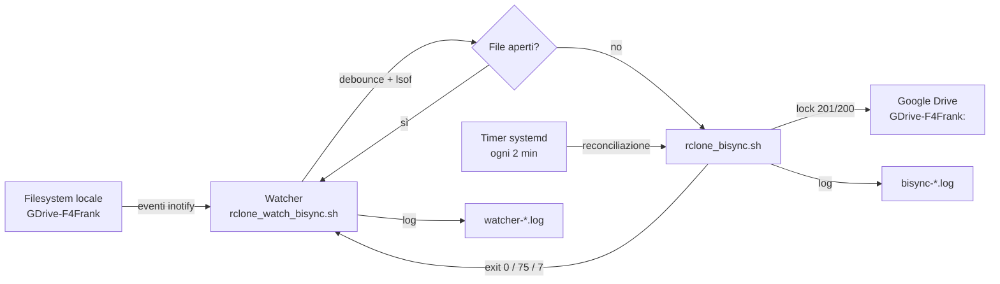
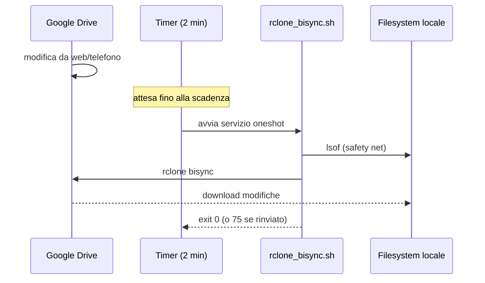
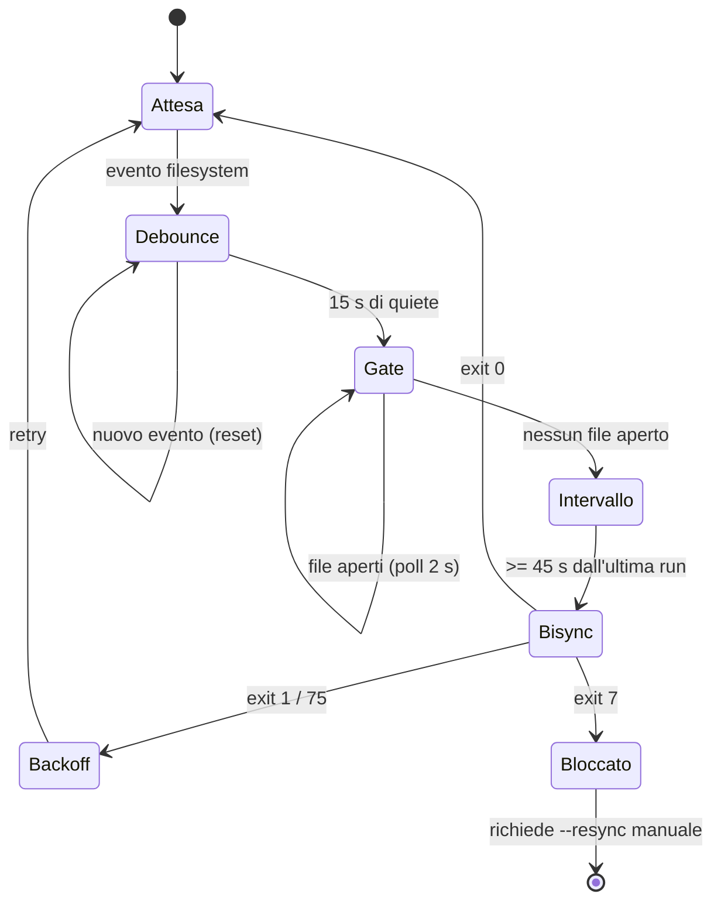

# Piano di implementazione — Conversione a servizi systemd

**File piano:** `docs/all_service_plan.md`  
**Repository:** `rclone-automation-suite`  
**Utente target:** `frankel`  
**Stato:** Implementazione realtime systemd completata e verificata (sintassi, `systemd-analyze` e test end-to-end con stub di `rclone`). Vedi §15.

> **Nota sui percorsi:** questo documento descrive il piano al momento della sua
> stesura. Dopo la riorganizzazione del repository gli script sono in `scripts/`,
> i test in `tests/`, i documenti in `docs/` e gli artefatti cron in `legacy/`.
> La struttura corrente è descritta in `AGENTS.md`.

---

## 1. Stato attuale del sistema (cosa esiste oggi)

Prima della conversione, il sistema era basato su:

| Componente | Percorso | Descrizione |
|---|---|---|
| Script bisync | `rclone_bisync.sh` | Sincronizzazione bidirezionale locale ↔ remote, lock a due livelli, safety check (lsof + find), auto-recovery (`--resync`), notifiche desktop |
| Script sync | `rclone_sync.sh` | Sincronizzazione unidirezionale remote → remote, lock a due livelli, safety check condizionato, notifiche desktop |
| Script di installazione | `setup.sh` | Copia script in `~/.bin`, wrapper in `/etc/cron.daily`, desktop file, crontab utente; richiede `sudo` |
| Script di disinstallazione | `unsetup.sh` | Rimuove gli stessi file; richiede `sudo` |
| Crontab utente | gestito da `setup.sh` / `unsetup.sh` | Riga `*/10 * * * *` per bisync + `@reboot sleep 60 ...` per bisync |
| Wrapper cron.daily | `utility/wrapper_sync_drive_to_mega.sh`, `utility/wrapper_sync_drive_to_drive.sh` | Eseguono `rclone_sync.sh` come utente `frankel` da `/etc/cron.daily` |
| Desktop autostart | `utility/login_rclone_bisync.desktop` | Esegue bisync al login grafico con `sleep 5` |
| File crontab sorgente | `utility/crontab.txt` | Contiene le due righe di crontab per bisync |
| Directory conf per remote | `~/.config/rclone/conf_dir_<REMOTE_NAME>/` | Contiene lock file e log file per ogni remote |

---

## 2. Obiettivo della conversione (raggiunto)

Spostare l'intero sistema su **systemd user services**, con il minor numero di unità possibile:

- ✅ Crontab utente sostituito da **timer systemd user**
- ✅ Wrapper `/etc/cron.daily` sostituiti da **timer systemd user**
- ✅ Desktop autostart sostituito da `loginctl enable-linger` + timer `OnBootSec`
- ✅ Logrotate gestito da `setup.sh`/`unsetup.sh` (con `sudo`), nessun servizio systemd dedicato
- ✅ Sistema **idempotente**: rilanciare `setup.sh` non duplica nulla
- ✅ Script di sincronizzazione non gestiscono più logrotate (rimosso da entrambi)

---

## 3. Decisioni architetturali

| Decisione | Scelta | Perché |
|---|---|---|
| Tipo unità | **User service** (`systemctl --user`) | Gli script usano path di `/home/frankel`, `notify-send` (sessione grafica D-Bus), leggono `~/.config/rclone/`. Come root non avrebbero accesso alla D-Bus dell'utente né ai file di configurazione rclone corretti. |
| Avvio al boot senza login | `loginctl enable-linger frankel` | I user service partono solo al login di default. `linger` permette all'istanza systemd user di `frankel` di restare attiva anche senza sessione aperta, equivalente al vecchio `@reboot` di crontab. |
| Template vs istanze | **Unità template** `rclone-bisync@.service` e `rclone-sync@.service` | Un singolo template gestisce tutte le istanze tramite `%i`. I parametri passano tramite `EnvironmentFile`. Minor numero di file da mantenere. |
| Scheduler | **Timer systemd** | `OnBootSec` sostituisce `@reboot sleep`, `OnUnitActiveSec` / `OnCalendar` sostituisce `*/10` e `/etc/cron.daily`. Gestione nativa del fallback se il sistema era spento. |
| Numero unità | 4 unità user (2 service template + 2 timer template) + 3 file `.env` | Rispetta il vincolo "minor numero di servizi possibile". |
| Logrotate | Gestito da `setup.sh`/`unsetup.sh` con `sudo` | `logrotate` di sistema già gira periodicamente. Serve solo installare/rimuovere i file in `/etc/logrotate.d/`. Richiede root, quindi non appartiene agli script user service. |

---

## 4. File creati (directory `systemd/user/`)

Tutti in `systemd/user/` del repository, copiati in `~/.config/systemd/user/` da `setup.sh`:

### 4.1 `rclone-bisync@.service` (template)

```
[Unit]
Description=Rclone bisync per istanza %i
Documentation=man:rclone(1)
After=network-online.target
Wants=network-online.target

[Service]
Type=oneshot
EnvironmentFile=-/home/frankel/.config/systemd/user/rclone-bisync-%i.env
ExecStart=/home/frankel/.bin/rclone_bisync.sh ${LOCAL_PATH} ${REMOTE_PATH}

[Install]
WantedBy=timers.target
```

- `Type=oneshot`: lo script esce quando finisce; systemd non tenta di tenerlo in esecuzione.
- `After=network-online.target` + `Wants=network-online.target`: rete disponibile prima di partire (più preciso del `sleep 60` del vecchio crontab).
- `EnvironmentFile=-...`: il trattino rende il file opzionale.

### 4.2 `rclone-sync@.service` (template)

Stessa struttura, richiama `rclone_sync.sh ${SOURCE_PATH} ${DEST_PATH}`.

### 4.3 `rclone-bisync@.timer` (template)

```
[Unit]
Description=Timer per rclone bisync (istanza %i)

[Timer]
OnBootSec=1min
OnUnitActiveSec=2min
AccuracySec=10s
Unit=rclone-bisync@%i.service
Persistent=true

[Install]
WantedBy=timers.target
```

- `OnBootSec=1min`: avvio 1 minuto dopo il boot (WiFi).
- `OnUnitActiveSec=2min` + `AccuracySec=10s`: riconciliazione remoto→locale circa ogni 2 minuti; per ridurre il carico API si può portare a `5min` o `10min`.
- `Persistent=true`: non esegue subito se il sistema era spento (comportamento simile a cron).

### 4.4 `rclone-sync@.timer` (template)

```
[Unit]
Description=Timer per rclone sync (istanza %i)

[Timer]
OnBootSec=5min
OnCalendar=daily
Unit=rclone-sync@%i.service
Persistent=true

[Install]
WantedBy=timers.target
```

- `OnCalendar=daily`: esecuzione giornaliera (sostituisce `/etc/cron.daily`).

### 4.5 File `.env` per istanza

| File | Contenuto | Usato da |
|---|---|---|
| `rclone-bisync-gdrive-f4frank.env` | `LOCAL_PATH=/home/frankel/GDrive-F4Frank`, `REMOTE_PATH=GDrive-F4Frank:` | `rclone-bisync@gdrive-f4frank.service` |
| `rclone-sync-drive-to-drive.env` | `SOURCE_PATH=GDrive-F4Frank:`, `DEST_PATH=GDrive-Pro:` | `rclone-sync@drive-to-drive.service` |
| `rclone-sync-drive-to-mega.env` | `SOURCE_PATH=GDrive-F4Frank:`, `DEST_PATH=Mega:` | `rclone-sync@drive-to-mega.service` |

### 4.6 Servizio watcher realtime (debounce)

`systemd/user/rclone-bisync-watcher@.service`:

```
[Unit]
Description=Watcher debounce realtime per rclone bisync istanza %i
Documentation=man:rclone(1)
After=network-online.target
Wants=network-online.target

[Service]
Type=simple
EnvironmentFile=-/home/frankel/.config/systemd/user/rclone-bisync-%i.env
Environment=MIN_INTERVAL=45 LSOF_POLL=2 LSOF_MAX_WAIT=1800 BACKOFF_START=10 BACKOFF_MAX=300
ExecStart=/home/frankel/.bin/rclone_watch_bisync.sh ${LOCAL_PATH} ${REMOTE_PATH} 15
Restart=on-failure
RestartSec=10
SuccessExitStatus=75

[Install]
WantedBy=default.target
```

- `Type=simple`: il watcher è un loop infinito, systemd lo mantiene in esecuzione.
- `Restart=on-failure` + `SuccessExitStatus=75`: il watcher viene riavviato per errori imprevisti, ma non quando è sospeso in attesa di un `--resync` manuale.
- `ExecStart`: lancia lo script watcher con `LOCAL_PATH`, `REMOTE_PATH` e debounce di 5 secondi.
- Non ha una sezione `[Timer]`: è un servizio, non un timer. Resta in ascolto continuo su `inotifywait`.

---

## 5. Gestione logrotate (incorporata in setup/unsetup)

**Nessun servizio systemd dedicato.** `logrotate` di sistema esegue già la rotazione periodica. `setup.sh` e `unsetup.sh` creano/rimuovono i file di configurazione in `/etc/logrotate.d/`.

### File logrotate creati da `setup.sh`

| File | Log di destinazione |
|---|---|
| `/etc/logrotate.d/rclone_bisync_gdrive-f4frank` | `~/.config/rclone/conf_dir_GDrive-F4Frank/log_files/bisync-GDrive-F4Frank.log` |
| `/etc/logrotate.d/rclone_sync_drive-to-drive` | `~/.config/rclone/conf_dir_GDrive-F4Frank/log_files/sync-GDrive-F4Frank_to_GDrive-Pro.log` |
| `/etc/logrotate.d/rclone_sync_drive-to-mega` | `~/.config/rclone/conf_dir_GDrive-F4Frank/log_files/sync-GDrive-F4Frank_to_Mega.log` |

Contenuto di ogni file:
```
"/percorso/log" {
    rotate 7
    daily
    missingok
    notifempty
    compress
    delaycompress
    copytruncate
}
```

### Pulizia in `unsetup.sh`

Rimuove i 3 file sopra + i vecchi file con naming convention precedente (`rclone_bisync_GDrive-F4Frank`, `rclone_sync_GDrive-F4Frank`) lasciati da installazioni precedenti.

---

## 6. Script di sincronizzazione: modifiche apportate

### `rclone_bisync.sh` e `rclone_sync.sh`

**Rimossa completamente la logica logrotate** (blocco che scriveva in `/etc/logrotate.d/` via `sudo tee`).

**Motivo:** Una volta che gli script girano come systemd user service (utente `frankel`, senza `sudo`), il comando `sudo tee` fallirebbe silenziosamente. La gestione logrotate spetta ora esclusivamente a `setup.sh`/`unsetup.sh` (eseguiti con `sudo`).

**Controllo file di log:** se `LOG_FILE` non esiste, viene creato con `touch`. Se `touch` fallisce (permessi negati), si invia notifica ed si esce con codice 1. La mancata esistenza del file di log **non è più un errore bloccante** (viene creato automaticamente).

---

## 7. `setup.sh` — implementazione completa

Lo script (richiede `sudo`) esegue in ordine:

1. **Verifica root:** `EUID -ne 0` → errore
2. **Crea directory:** `~/.bin`, `~/.config/autostart`, `~/.config/systemd/user/`
3. **Copia script:** `rclone_bisync.sh`, `rclone_sync.sh` in `~/.bin/` (con `chmod +x`)
4. **Copia unità systemd:** 4 file template (2 service + 2 timer) in `~/.config/systemd/user/`
5. **Copia file `.env`:** 3 file per le 3 istanze in `~/.config/systemd/user/`
6. **Abilita linger:** `loginctl enable-linger frankel` (avvio al boot senza login)
7. **Gestisce logrotate:** per ogni istanza, crea/aggiorna `/etc/logrotate.d/rclone_*` (idempotente: se contenuto uguale, non sovrascrive)
8. **Ricarica systemd:** `sudo -u frankel XDG_RUNTIME_DIR=/run/user/1000 systemctl --user daemon-reload`
9. **Abilita timer:** `enable --now` per i 3 timer (idempotente: systemd non duplica)
10. **Copia desktop file:** `login_rclone_bisync.desktop` (retro-compatibilità)
11. **Rimuove crontab utente:** le righe da `utility/crontab.txt` vengono rimosse (sostituite dai timer)

### Idempotenza

- `cp` sovrascrive file esistenti (nessun duplicato)
- `systemctl enable --now` su unità già abilitate non produce errori
- Logrotate: confronto contenuto prima di sovrascrivere
- Crontab: rimozione basata su pattern da `utility/crontab.txt`, lascia intatti gli altri job

---

## 8. `unsetup.sh` — implementazione completa

Lo script (richiede `sudo`) esegue in ordine:

1. **Stop timer:** `systemctl --user stop` per i 3 timer
2. **Disable timer:** `systemctl --user disable` per i 3 timer
3. **Rimuove logrotate:** file in `/etc/logrotate.d/` (nuovo naming + vecchio naming)
4. **Ricarica systemd:** `daemon-reload` come utente frankel
5. **Disabilita linger:** `loginctl disable-linger frankel` (opzionale)
6. **Rimuove unità:** 4 file template + 3 file `.env` da `~/.config/systemd/user/`
7. **Rimuove script:** `rclone_bisync.sh`, `rclone_sync.sh` da `~/.bin/`
8. **Rimuove wrapper:** da `/etc/cron.daily/`
9. **Rimuove desktop file:** da `~/.config/autostart/`
10. **Rimuove crontab:** righe rclone da crontab di `frankel`

---

## 9. Flusso logico del nuovo sistema

```
Boot sistema
    │
    ▼
loginctl enable-linger (eseguito una volta da setup.sh)
    │
    ▼
systemd --user di frankel si avvia al boot (senza login necessario)
    │
    ├─── rclone-bisync@gdrive-f4frank.timer ──┐
    │   OnBootSec=1min                        │
    │   OnUnitActiveSec=2min                  │
    │   ▼                                     │
    │   rclone-bisync@gdrive-f4frank.service  │
    │   Type=oneshot                          │
    │   EnvironmentFile: rclone-bisync-gdrive-f4frank.env
    │   ExecStart: rclone_bisync.sh $LOCAL_PATH $REMOTE_PATH
    │                                           │
    ├─── rclone-sync@drive-to-drive.timer ────┤
    │   OnBootSec=5min                        │
    │   OnCalendar=daily                      │
    │   ▼                                     │
    │   rclone-sync@drive-to-drive.service    │
    │                                         │
    └─── rclone-sync@drive-to-mega.timer ─────┘
        OnBootSec=5min
        OnCalendar=daily
        ▼
        rclone-sync@drive-to-mega.service

Ogni servizio:
  └─ legge .env per LOCAL_PATH/REMOTE_PATH (o SOURCE_PATH/DEST_PATH)
  └─ esegue lo script bash corrispondente
  └─ lo script usa lock flock (FD 200 + FD 201) per evitare sovrapposizioni
  └─ output → file di log in ~/.config/rclone/conf_dir_*/log_files/
  └─ logrotate di sistema ruota i log in base a /etc/logrotate.d/rclone_*
  └─ notifiche desktop via notify-send (DBUS_SESSION_BUS_ADDRESS gestito nello script)
```

---

## 10. Rischi e mitigazioni

| Rischio | Mitigazione |
|---|---|
| `systemctl --user` da root senza `XDG_RUNTIME_DIR` | Usato `sudo -u frankel XDG_RUNTIME_DIR=/run/user/1000 systemctl --user ...` |
| User service non parte al boot senza login | `loginctl enable-linger frankel` eseguito da `setup.sh` |
| `notify-send` fallisce al boot senza sessione grafica | Lo script imposta `DBUS_SESSION_BUS_ADDRESS` di fallback; `|| true` sulla notifica |
| Sovrapposizione esecuzioni | I lock `flock` a due livelli (FD 200 + FD 201) negli script restano invariati |
| User service senza sudo non scrive `/etc/logrotate.d/` | Spostata in `setup.sh`/`unsetup.sh` (eseguiti con `sudo`) |
| `logrotate` non esegue se i file mancano | `setup.sh` li crea all'installazione; `logrotate` di sistema li raccoglie automaticamente |
| Path hardcoded `/home/frankel` | Coerente con l'esistente; documentato come adattare per altri utenti |
| `systemd --user` non ancora avvitato al momento di `daemon-reload` | `loginctl enable-linger` avvia l'istanza user; `daemon-reload` e `enable --now` funzionano |

---

## 11. Out of scope

- Creazione di un servizio systemd dedicato per logrotate (ridondante: `logrotate` di sistema già gira; gestito da `setup.sh`/`unsetup.sh`)
- Wrapper `rclone_copy_*` in `utility/` (non installati da `setup.sh`, non convertiti)
- Test in `test/` (non convertiti)
- Supporto utenti diversi da `frankel` (path hardcoded, come nell'esistente)

---

## 12. Verifica post-installazione

Dopo `sudo ./setup.sh`:

```bash
# Verifica timer attivi
sudo -u frankel XDG_RUNTIME_DIR=/run/user/$(id -u frankel) systemctl --user list-timers --all --no-pager | grep rclone

# Verifica linger abilitato
loginctl show-user frankel | grep Linger

# Verifica file logrotate
ls -la /etc/logrotate.d/rclone_*

# Esecuzione manuale di un servizio
sudo -u frankel XDG_RUNTIME_DIR=/run/user/$(id -u frankel) systemctl --user start rclone-bisync@gdrive-f4frank.service
sudo -u frankel XDG_RUNTIME_DIR=/run/user/$(id -u frankel) systemctl --user status rclone-bisync@gdrive-f4frank.service --no-pager
```

Dopo `sudo ./unsetup.sh`:

```bash
# Nessun timer rclone attivo
sudo -u frankel XDG_RUNTIME_DIR=/run/user/$(id -u frankel) systemctl --user list-timers --all --no-pager | grep rclone  # dovrebbe essere vuoto

# Nessun file logrotate rclone
ls /etc/logrotate.d/rclone_*  # dovrebbe fallire

# Nessuna unità in ~/.config/systemd/user/
ls ~/.config/systemd/user/  # dovrebbe essere vuoto o non contenere file rclone
```

---

## 13. Idempotenza

Lanciare due volte di seguito `sudo ./setup.sh`:

1. La seconda esecuzione non duplica i timer (systemd gestisce l'idempotenza di `enable --now`)
2. Non sovrascrive i file logrotate se il contenuto è identico
3. Non produce errori se le unità sono già presenti
4. Il crontab utente viene ripulito (se già pulito, nessuna modifica)

---

## 14. File modificati/creati (riepilogo)

| File | Azione | Descrizione |
|---|---|---|
| `systemd/user/rclone-bisync@.service` | Creato | Template servizio bisync |
| `systemd/user/rclone-sync@.service` | Creato | Template servizio sync |
| `systemd/user/rclone-bisync@.timer` | Creato | Template timer bisync |
| `systemd/user/rclone-sync@.timer` | Creato | Template timer sync |
| `systemd/user/rclone-bisync-gdrive-f4frank.env` | Creato | Variabili ambiente bisync gdrive-f4frank |
| `systemd/user/rclone-sync-drive-to-drive.env` | Creato | Variabili ambiente sync drive-to-drive |
| `systemd/user/rclone-sync-drive-to-mega.env` | Creato | Variabili ambiente sync drive-to-mega |
| `setup.sh` | Modificato | Aggiunto: unità systemd, .env, linger, logrotate, timer enable, rimozione crontab |
| `unsetup.sh` | Modificato | Aggiunto: timer stop/disable, logrotate remove, linger disable, unità remove |
| `rclone_bisync.sh` | Modificato | Rimosso blocco logrotate; controllo file log non più bloccante |
| `rclone_sync.sh` | Modificato | Rimosso blocco logrotate; controllo file log non più bloccante |

---

## 15. Implementazione realtime (bisync bidirezionale)

### 15.1 Obiettivo e vincoli

Obiettivo: sincronizzazione bidirezionale tra la cartella locale e Google Drive con latenza di pochi secondi nel verso locale→remoto e di pochi minuti nel verso remoto→locale, evitando il più possibile sync fallite o scartate.

Vincoli concordati:

- il motore resta `rclone bisync` bidirezionale;
- il blocco `RCLONE_CMD` non viene modificato finché i nuovi flag non sono testati;
- le cancellazioni si propagano con il comportamento standard di bisync (nessun `--backup-dir`, nessun `--max-delete` aggiuntivo);
- ai conflitti vince il più recente;
- debounce 10–20 s, intervallo minimo tra run 30–60 s.

### 15.2 Architettura



Il watcher è l'unico scrittore verso il remoto in tempo reale; il timer è la rete di sicurezza che copre il verso remoto→locale e gli eventi persi.

### 15.3 Flusso locale → remoto

```mermaid
sequenceDiagram
    participant U as Utente/App
    participant FS as Filesystem locale
    participant W as Watcher
    participant S as rclone_bisync.sh
    participant D as Google Drive

    U->>FS: salva file (close_write)
    FS-->>W: evento inotify
    W->>W: debounce 15 s
    W->>W: lsof: file aperti?
    Note over W: attende finché lsof è pulito
    W->>S: esegue bisync
    S->>S: flock 201 (attesa max 120 s)
    S->>D: rclone bisync
    D-->>S: esito (0 / 1 / 7)
    S-->>W: exit code
    W->>W: log; backoff se 75/1
```

### 15.4 Flusso remoto → locale



Con `OnUnitActiveSec=2min` e `AccuracySec=10s` la latenza remoto→locale è circa 2 minuti più la durata della run. Portare `OnUnitActiveSec` a `5min` o `10min` riduce il carico API senza cambiare l'architettura; con 10 minuti la finestra di conflitto e il ritardo delle cancellazioni remote crescono proporzionalmente.

### 15.5 Macchina a stati del watcher



### 15.6 Modifiche implementate: perché e impatto

| File | Modifica | Perché | Impatto |
|---|---|---|---|
| `rclone_bisync.sh` | `DEBUG_MODE=0` | con `1` non avveniva la redirezione al file di log | log `bisync-*.log` popolato e logrotate utile |
| `rclone_bisync.sh` | create `log_files/` e `lock_files/` | su installazione pulita `touch` e i redirettori `flock` fallivano | installazione pulita funzionante |
| `rclone_bisync.sh` | rimosso `find -mmin -1` | dopo un salvataggio è sempre vero: ogni sync realtime veniva scartata | la sync parte appena la directory è quieta |
| `rclone_bisync.sh` | rinvio con `exit 75` | `exit 0` confondeva "rimandato" con "sincronizzato" | il watcher ritenta; systemd non segna failed |
| `rclone_bisync.sh` | `flock -w 120` su FD 201 | watcher e timer si sovrapponevano e il secondo usciva 1 | attesa limitata, poi rinvio; nessuna sync fallita |
| `rclone_bisync.sh` | cattura dell'exit code di rclone | `if ! cmd` non distingue 1 (ritentabile) da 7 (critico) | recupero differenziato |
| `rclone_bisync.sh` | `--resync` solo su exit 7 e a directory quieta | il resync automatico su ogni errore è pesante e non propaga le cancellazioni | meno resync, nessun resync con file aperti |
| `rclone_bisync.sh` | marker `.blocked` su resync fallito | evita loop di resync | il watcher si sospende fino a intervento manuale |
| `utility/rclone_watch_bisync.sh` | `inotifywait -m` su FIFO | il codice precedente riarmava il watch e perdeva eventi durante la sync | nessun evento perso |
| `utility/rclone_watch_bisync.sh` | debounce reale con `read -t` | reset corretto a ogni evento | 15 s di quiete effettiva |
| `utility/rclone_watch_bisync.sh` | gate `lsof` a polling | `continue` aspettava un nuovo evento: se il file restava aperto non ripartiva | riparte appena i file sono chiusi |
| `utility/rclone_watch_bisync.sh` | rimosso `find -mmin -1` | incompatibile con il realtime | nessuno skip per mtime recente |
| `utility/rclone_watch_bisync.sh` | rimossi i probe dei lock | TOCTOU: passavano e poi lo script falliva | lock gestito dallo script con attesa |
| `utility/rclone_watch_bisync.sh` | intervallo minimo 45 s e backoff | evita un bisync a ogni salvataggio e i retry ravvicinati | meno API, meno 429 |
| `systemd/user/rclone-bisync@.service` | `SuccessExitStatus=75` | il rinvio non è un fallimento | stato unità corretto |
| `systemd/user/rclone-bisync@.timer` | `OnUnitActiveSec=2min`, `AccuracySec=10s` | copre il verso remoto→locale | latenza circa 2 min, più run |
| `systemd/user/rclone-bisync-watcher@.service` | `Restart=on-failure`, debounce 15 s | `Restart=always` riavviava anche il caso bloccato | nessun loop di riavvio |
| `setup.sh` | directory, `exclude_patterns.txt`, `RCLONE_TEST`, logrotate watcher | prerequisiti mancanti | prima installazione senza errori |
| `unsetup.sh` | rimozione logrotate watcher e marker | pulizia completa | reinstallazione pulita |

### 15.7 Test eseguiti

Harness con stub di `rclone` e albero temporaneo:

| Test | Atteso | Esito |
|---|---|---|
| Lock remoto occupato | `exit 75` entro ~1 s | 75, 1,3 s |
| File aperto nella sorgente | `exit 75` dopo i tentativi | 75, 2,7 s |
| Run normale | `exit 0` | 0 |
| rclone `exit 1` | nessun resync, `exit 75` | 75 |
| rclone `exit 7`, resync ok | `exit 0`, marker assente | 0, assente |
| rclone `exit 7`, resync ko | `exit 7`, marker presente | 7, presente |
| Watcher con file aperto | nessuna chiamata | 0 chiamate |
| Watcher dopo chiusura | chiamata senza altri eventi | 1 chiamata |
| Evento durante la run | seconda chiamata dopo la prima | 2 chiamate |
| Cleanup watcher | nessun `inotifywait`, FIFO rimossa | ok |

Verifiche statiche: `bash -n` su tutti gli script e `systemd-analyze verify` sulle unità (unico avviso atteso: lo script non è ancora installato in `~/.bin`).

### 15.8 Nuovi flag: stato

`--conflict-resolve newer` e `--resync-mode newer` **non sono stati inseriti**: il blocco `RCLONE_CMD` è rimasto invariato. Vanno aggiunti solo dopo i test dei casi di conflitto descritti nella fase 5 del piano precedente. Con `--conflict-resolve newer` il perdente viene rinominato `.conflict1` (comportamento di default `--conflict-loser num`), quindi non viene cancellato.

### 15.9 Limiti noti

- `--remove-empty-dirs` elimina le directory vuote a ogni run.
- `--compare modtime` non confronta la dimensione.
- I file `.conflictN` possono accumularsi.
- `lsof +D` costa O(albero): su alberi molto grandi il gate è più lento.
- La coda inotify del kernel (`max_queued_events = 16384`) può overfloware su burst enormi; il timer riconcilia.
- Il verso remoto→locale resta a polling: bisync non ha un watch.
- Un `exit 7` richiede intervento manuale (`--resync` e rimozione del marker).
